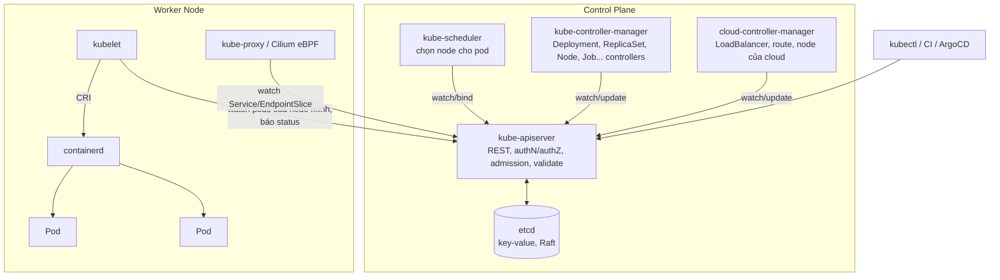
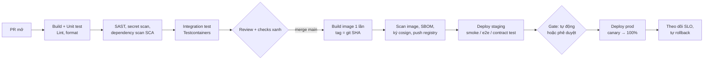
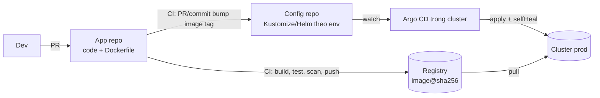
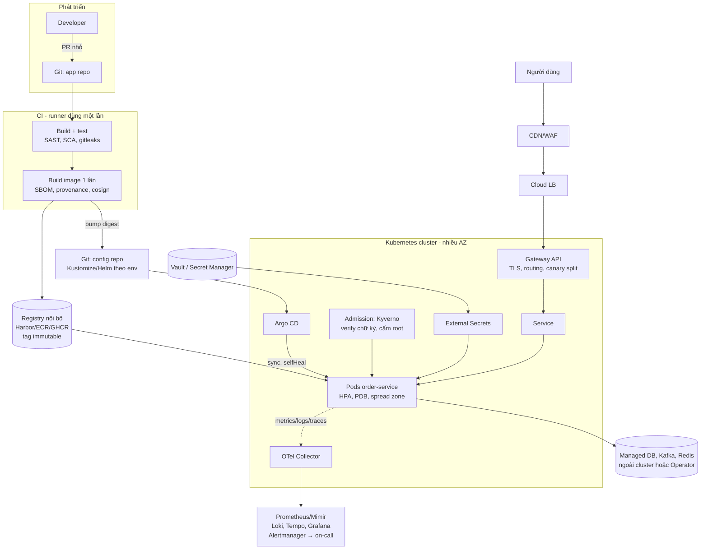

# Linux, Docker, Kubernetes & CI/CD — Kiến trúc hạ tầng cho Backend Engineer

Tài liệu ôn tập **hạ tầng chạy ứng dụng** dành cho Backend/Java engineer: từ Linux (process, memory, namespace, cgroup) → Docker (image, runtime, Dockerfile) → Kubernetes (control plane, workload, scheduling, probe, bảo mật) → CI/CD (pipeline, GitOps, deploy an toàn, supply chain) → kiến trúc tham chiếu end-to-end, checklist production và câu hỏi phỏng vấn.

> 💡 **Tài liệu liên quan**:
> - [`Networking.md`](Networking.md): mục 11 — VPC, Service/kube-proxy, CoreDNS, Ingress, NetworkPolicy (tài liệu này chỉ tóm tắt phần mạng K8s).
> - [`SpringBoot.md`](SpringBoot.md): mục 13 — Actuator probes, tối ưu khởi động, **graceful shutdown trên K8s**; mục 14 — cấu hình 12-factor.
> - [`SystemDesign.md`](SystemDesign.md): mục 1.5 Auto-scaling, 5.4 Service mesh, 5.5 Deployment strategies, 9 Observability.
> - [`security-architecture-vi.md`](security-architecture-vi.md): mục 10 — Chuỗi cung ứng phần mềm & DevSecOps.
> - [`SeniorGaps.md`](SeniorGaps.md): các bug thật liên quan nhiều pod, secret trong `docker-compose.yml`, Testcontainers.

## 📖 Cách đọc tài liệu này

Mỗi chương viết theo mạch **Bài toán → Cách giải → Áp dụng**:

| Ký hiệu | Ý nghĩa |
| :--- | :--- |
| 🎯 **Bài toán** | Vấn đề thực tế cần giải quyết — vì sao kỹ thuật này tồn tại |
| ❌ **Cách ngây thơ** | Cách làm "tự nhiên nhất" và lý do nó không đủ |
| 💡 **Ý tưởng giải** | Nguyên lý cốt lõi của giải pháp |
| ⚖️ **Các phương án** | Bảng ưu/nhược điểm khi có nhiều lựa chọn |
| ✅ **Vì sao chọn** | Hệ thống thực tế chọn phương án nào, trong điều kiện nào |
| 🛠 **Áp dụng** | Dùng vào công việc / thiết kế / debug thế nào |
| 🧠 **Tự kiểm tra** | Câu hỏi "tại sao" để tự đánh giá (bấm để xem đáp án) |

### 🗺 Chuỗi bài toán: từ dòng code đến pod chạy trên production

```
 Code chạy thành process trên một máy Linux; cần hiểu nó dùng CPU/RAM/fd thế nào → Linux (1)
 "Chạy được trên máy tôi" nhưng lỗi trên server; nhiều app tranh tài nguyên        → cô lập bằng namespace + cgroup (2)
   └─ gói app + toàn bộ phụ thuộc thành 1 artifact bất biến, chạy giống nhau ở mọi nơi → container image, Docker (3, 4, 5)
 Hàng trăm container trên hàng chục máy: ai đặt ở đâu, chết thì ai dựng lại?       → orchestrator: Kubernetes (6)
   ├─ mô tả loại workload (stateless, stateful, job, agent mỗi node)                 → Deployment, StatefulSet, Job, DaemonSet (7)
   ├─ cấu hình, secret, ổ đĩa tách khỏi image                                        → ConfigMap, Secret, PV/PVC (8)
   ├─ chia tài nguyên công bằng, co giãn theo tải                                   → requests/limits, QoS, HPA, autoscaler (9)
   ├─ biết pod sống/sẵn sàng, dừng không rơi request                                  → probes, lifecycle, rolling update (10)
   ├─ gọi nhau theo tên ổn định, nhận traffic từ ngoài                                → Service, Gateway API, NetworkPolicy (11)
   └─ một pod bị chiếm không lan ra cả cluster                                        → RBAC, Pod Security, securityContext (12)
 Nhiều môi trường, nhiều service, nhiều file YAML                                     → Helm / Kustomize (13)
 Pod lỗi lúc 2h sáng                                                                   → quy trình chẩn đoán K8s (14)
 Mỗi commit phải được build/test/đóng gói/deploy tự động, an toàn, lặp lại được      → pipeline CI/CD (15, 16)
   ├─ ai "đẩy" thay đổi vào cluster, làm sao biết cluster đang chạy gì               → push vs GitOps (17)
   ├─ phát hành phiên bản mới mà không sập, rollback được, kể cả schema DB           → progressive delivery, expand–contract (18)
   └─ pipeline là mục tiêu tấn công                                                   → supply chain security (20)
 Đo xem đội giao hàng nhanh và ổn định cỡ nào                                         → DORA metrics (21)
```

---

## Mục lục

**Phần I — Linux**
1. [Linux cho Backend: process, memory, file descriptor](#1-linux-cho-backend-process-memory-file-descriptor)
2. [Nền móng của container: namespace, cgroup, overlayfs](#2-nền-móng-của-container-namespace-cgroup-overlayfs)

**Phần II — Docker**

3. [Kiến trúc Docker & chuẩn OCI](#3-kiến-trúc-docker--chuẩn-oci)
4. [Dockerfile & image production-ready (kèm Java)](#4-dockerfile--image-production-ready-kèm-java)
5. [Docker networking, storage & Compose](#5-docker-networking-storage--compose)

**Phần III — Kubernetes**

6. [Kiến trúc Kubernetes: control plane & reconcile loop](#6-kiến-trúc-kubernetes-control-plane--reconcile-loop)
7. [Workload: Pod, Deployment, StatefulSet, DaemonSet, Job](#7-workload-pod-deployment-statefulset-daemonset-job)
8. [Cấu hình & lưu trữ: ConfigMap, Secret, PV/PVC](#8-cấu-hình--lưu-trữ-configmap-secret-pvpvc)
9. [Tài nguyên, scheduling & autoscaling](#9-tài-nguyên-scheduling--autoscaling)
10. [Health check, vòng đời pod & rolling update](#10-health-check-vòng-đời-pod--rolling-update)
11. [Mạng trong Kubernetes (tóm tắt)](#11-mạng-trong-kubernetes-tóm-tắt)
12. [Bảo mật Kubernetes](#12-bảo-mật-kubernetes)
13. [Đóng gói & đa môi trường: Helm vs Kustomize](#13-đóng-gói--đa-môi-trường-helm-vs-kustomize)
14. [Troubleshooting Kubernetes](#14-troubleshooting-kubernetes)

**Phần IV — CI/CD**

15. [Kiến trúc pipeline CI/CD](#15-kiến-trúc-pipeline-cicd)
16. [Chiến lược nhánh & versioning artifact](#16-chiến-lược-nhánh--versioning-artifact)
17. [Mô hình deploy: Push vs GitOps](#17-mô-hình-deploy-push-vs-gitops)
18. [Phát hành an toàn: progressive delivery & migration DB](#18-phát-hành-an-toàn-progressive-delivery--migration-db)
19. [Ví dụ đầy đủ: Spring Boot → GitHub Actions → GitOps → K8s](#19-ví-dụ-đầy-đủ-spring-boot--github-actions--gitops--k8s)
20. [Bảo mật chuỗi cung ứng trong CI/CD](#20-bảo-mật-chuỗi-cung-ứng-trong-cicd)
21. [Đo hiệu quả delivery: DORA metrics](#21-đo-hiệu-quả-delivery-dora-metrics)

**Phần V — Tổng hợp**

22. [Kiến trúc tham chiếu end-to-end](#22-kiến-trúc-tham-chiếu-end-to-end)
23. [Checklist production-ready cho một service](#23-checklist-production-ready-cho-một-service)
24. [Câu hỏi phỏng vấn](#24-câu-hỏi-phỏng-vấn)
25. [Lộ trình thực hành & tài nguyên](#25-lộ-trình-thực-hành--tài-nguyên)

---

# Phần I — Linux

## 1. Linux cho Backend: process, memory, file descriptor

> 🎯 **Bài toán:** Service Java "tự nhiên chậm", "bị kill không rõ lý do", "Too many open files", "CPU 100% nhưng không có request". Không hiểu tầng OS thì chỉ đoán.
>
> 💡 **Ý tưởng:** Mọi thứ app làm với phần cứng đều đi qua **kernel** bằng **system call**. Nắm 4 tài nguyên kernel quản lý — **CPU (scheduler), bộ nhớ (virtual memory), I/O (file descriptor), tín hiệu (signal)** — là đủ giải thích hầu hết sự cố vận hành.

### 1.1. Kernel space vs User space

```
┌──────────────── User space ────────────────┐
│  JVM (app)   nginx   postgres   bash        │   ← không chạm trực tiếp phần cứng
│      │  glibc / musl (thư viện C)            │
└──────┼──────────────────────────────────────┘
       │ system call: read, write, open, mmap, clone, epoll_wait, futex...
┌──────▼──────────── Kernel space ────────────┐
│ Scheduler │ Memory mgmt │ VFS/FS │ Network stack │ Namespaces/cgroups │ Drivers │
└───────────────────────────────────────────────┘
                    Phần cứng (CPU, RAM, disk, NIC)
```
- Syscall có chi phí (chuyển chế độ CPU, copy dữ liệu) → lý do tồn tại **buffer**, **batch**, **zero-copy** (`sendfile`), **epoll** (`Java.md` mục 15).
- `strace -f -p <pid>` xem process đang gọi syscall gì — công cụ mạnh nhất khi app "treo không log".

### 1.2. Process, thread & signal

- **Process** = không gian địa chỉ riêng + tài nguyên (fd, PID...). **Thread** trên Linux cũng là một "task" được tạo bằng `clone()` nhưng **chia sẻ** bộ nhớ → mỗi Java platform thread = 1 thread của kernel (virtual thread thì không — `Java.md`).
- Tạo process: `fork()` (nhân bản, copy-on-write) + `exec()` (nạp chương trình mới).
- **PID 1** đặc biệt: là cha nuôi của mọi process mồ côi, phải **reap zombie** (`wait()`), và kernel **không áp dụng hành vi mặc định** của signal cho PID 1 → nếu PID 1 không tự cài handler thì `SIGTERM` bị **bỏ qua**. Đây là gốc của lỗi "container mất 30s mới dừng" (mục 4.3).
- Signal cần nhớ:

| Signal | Số | Bắt được? | Dùng khi |
|---|---|---|---|
| `SIGTERM` | 15 | ✅ | Yêu cầu dừng lịch sự — Docker/K8s gửi đầu tiên → app graceful shutdown |
| `SIGKILL` | 9 | ❌ | Giết ngay — sau grace period, hoặc OOM killer |
| `SIGINT` | 2 | ✅ | Ctrl+C |
| `SIGHUP` | 1 | ✅ | Thường dùng để reload cấu hình (nginx) |
| `SIGQUIT` | 3 | ✅ | JVM in **thread dump** ra stdout (`kill -3 <pid>`) |

- **Exit code** = `128 + số signal` khi bị signal giết: **137** = SIGKILL (thường là **OOMKilled**), **143** = SIGTERM. Gặp ở `kubectl describe pod` rất thường xuyên.
- Trạng thái process: `R` running, `S` sleep (chờ được ngắt), `D` **uninterruptible sleep** (thường chờ I/O đĩa/NFS — không kill được, làm tăng load average), `Z` zombie.

### 1.3. Bộ nhớ: virtual memory, page cache, OOM killer

- Mỗi process thấy **không gian địa chỉ ảo** riêng; kernel ánh xạ sang RAM vật lý theo **page** (4KB) khi thực sự chạm tới (lazy allocation).
  - **VSZ**: tổng địa chỉ ảo đã xin (JVM thường rất lớn — vô hại).
  - **RSS**: phần đang nằm trong RAM — con số cần theo dõi.
- **Page cache**: kernel dùng RAM trống làm cache cho file → `free -h` thấy "used" cao không có nghĩa thiếu RAM; xem cột **available**.
- **Overcommit**: kernel cho phép xin nhiều hơn RAM có thật; khi thật sự hết, **OOM killer** chọn process (theo `oom_score`) để `SIGKILL`.
- Trong container, giới hạn là **cgroup memory** (mục 2.2), không phải RAM của máy. Page cache cũng tính vào cgroup (nhưng được thu hồi trước khi OOM).
- 🛠 **Bộ nhớ JVM ≠ heap**: RSS = heap + metaspace + code cache + **thread stack** (mỗi thread ~1MB) + direct buffer (Netty) + GC overhead + native (JNI, glibc malloc arena). Đặt `-Xmx` bằng memory limit gần như chắc chắn bị OOMKilled → xem 4.4.

### 1.4. File descriptor & "mọi thứ là file"

- Mỗi file, **socket**, pipe, epoll instance đều là một **fd** (số nguyên) trong bảng fd của process. Giới hạn: `ulimit -n` (per process), `/proc/sys/fs/file-max` (toàn hệ thống).
- `Too many open files` = cạn fd → thường do **leak** (không đóng `InputStream`, HTTP response, connection) chứ không phải do thiếu limit. Kiểm tra: `ls /proc/<pid>/fd | wc -l`, `lsof -p <pid>`.
- `/proc` và `/sys` là "file ảo" kernel phơi ra: `/proc/<pid>/status` (RSS, threads), `/proc/<pid>/limits`, `/proc/loadavg`, `/sys/fs/cgroup/...`.
- **inode**: metadata của file; đĩa có thể "đầy" vì hết inode dù còn dung lượng (`df -i`). File đã xóa nhưng process còn mở → dung lượng **không được giải phóng** (`lsof +L1`) — lỗi kinh điển khi xóa file log đang được ghi.

### 1.5. Load average, CPU & các công cụ chẩn đoán

- **Load average** (1/5/15 phút) = số task **đang chạy + chờ CPU + đang ở trạng thái D**. So với số core: load 8 trên máy 8 core là "đầy", trên máy 32 core là nhàn. Load cao mà CPU thấp → nghẽn I/O (trạng thái D).
- CPU time: `us` (user), `sy` (kernel — cao bất thường = quá nhiều syscall/context switch), `wa` (chờ I/O), `st` (**steal** — VM bị host lấy CPU), trong container còn có **throttling** (mục 9.2).

🛠 **Bộ công cụ theo phương pháp USE** (Utilization – Saturation – Errors, `SystemDesign.md` 9.2):

| Tài nguyên | Công cụ | Nhìn gì |
|---|---|---|
| CPU | `top`/`htop`, `mpstat -P ALL 1`, `pidstat -t 1` | %us/%sy/%st, thread nào ngốn CPU (đổi TID sang hex → tìm trong `jstack`) |
| Memory | `free -h`, `vmstat 1`, `cat /proc/<pid>/status`, `dmesg -T \| grep -i oom` | available, si/so (swap), dấu vết OOM killer |
| Disk I/O | `iostat -xz 1`, `iotop`, `df -h`, `df -i` | `%util`, `await`, đầy đĩa/inode |
| Network | `ss -s`, `ss -tanp`, `sar -n DEV 1` | số kết nối theo trạng thái (TIME_WAIT/CLOSE_WAIT — `Networking.md` 3.3) |
| Process | `strace -f -p`, `lsof -p`, `perf top`, `journalctl -u <svc>` | syscall đang chờ, fd, hot function, log systemd |

> Quy trình 60 giây (Brendan Gregg): `uptime` → `dmesg -T | tail` → `vmstat 1` → `mpstat -P ALL 1` → `pidstat 1` → `iostat -xz 1` → `free -m` → `sar -n DEV 1` → `sar -n TCP,ETCP 1` → `top`.

### 1.6. systemd (khi chạy ngoài container)
- PID 1 trên hầu hết distro; quản lý service qua **unit file**: `Restart=on-failure`, `LimitNOFILE=`, `MemoryMax=` (cũng dùng cgroup), `User=` (không chạy root). Log qua `journalctl -u app -f`.
- Lý do vẫn cần biết: node K8s chạy **kubelet** và **containerd** bằng systemd — debug node là debug systemd.

<details>
<summary>🧠 Tự kiểm tra</summary>

1. **Pod bị restart với exit code 137 nhưng heap dump cho thấy heap mới dùng 60%. Vì sao?** — Bộ nhớ bị tính là RSS toàn process trong cgroup: heap + metaspace + thread stack + direct buffer + native. Phần ngoài heap có thể vượt limit → kernel OOM kill (SIGKILL = 137). Cần đặt `MaxRAMPercentage` để chừa 25–35% cho phần non-heap và theo dõi bằng Native Memory Tracking.
2. **Đã xóa file log 20GB nhưng `df` vẫn báo đầy?** — Process vẫn giữ fd tới file (inode chưa được giải phóng). Restart process, hoặc truncate (`: > file`) thay vì xóa; dài hạn dùng logrotate với `copytruncate` hoặc log ra stdout.
3. **Load average 20 trên máy 8 core nhưng CPU idle 70%?** — Nhiều task ở trạng thái D chờ I/O (đĩa chậm, NFS treo). Xem `iostat`, `ps -eo state,cmd | grep ^D`.
</details>

---

## 2. Nền móng của container: namespace, cgroup, overlayfs

> 🎯 **Bài toán:** Chạy nhiều ứng dụng trên một máy sao cho mỗi app tưởng mình có máy riêng (cây process, mạng, filesystem riêng), không app nào ăn hết tài nguyên của app khác — nhưng nhẹ hơn máy ảo rất nhiều.
>
> ❌ **Cách ngây thơ:** Mỗi app một VM → mỗi VM một kernel, khởi động tính bằng phút, tốn RAM cho OS khách.
>
> 💡 **Ý tưởng:** **Container = một process Linux bình thường** được kernel "đeo kính": **namespace** giới hạn những gì nó *nhìn thấy*, **cgroup** giới hạn những gì nó *được dùng*, **overlayfs** cho nó một root filesystem riêng xếp lớp từ image, **capabilities + seccomp** giới hạn những gì nó *được làm*. Tất cả container **dùng chung kernel** của host.

### 2.1. Namespace — cô lập tầm nhìn

| Namespace | Cô lập | Hệ quả thực tế |
|---|---|---|
| `pid` | Cây process | App trong container là PID 1 (→ vấn đề signal, mục 4.3) |
| `net` | Interface, IP, route, iptables, port | Mỗi container có `eth0` riêng; các container **trong cùng pod K8s chung net namespace** → gọi nhau qua `localhost` |
| `mnt` | Điểm mount | Root filesystem riêng từ image |
| `uts` | Hostname | `HOSTNAME` = tên pod trên K8s |
| `ipc` | Shared memory, semaphore | — |
| `user` | UID/GID | root trong container ánh xạ thành user thường ngoài host (rootless) |
| `cgroup` | Cây cgroup nhìn thấy | App thấy giới hạn của chính mình |

- Thử: `unshare --pid --fork --mount-proc bash` rồi `ps aux` → chỉ thấy 2 process. `nsenter -t <pid> -n ss -tanp` → vào net namespace của container để debug mạng **dù image không có công cụ**.

### 2.2. cgroup v2 — giới hạn tài nguyên

- Cây thư mục tại `/sys/fs/cgroup`; mỗi container/pod là một nhánh với các file điều khiển:

| File | Ý nghĩa | Map từ K8s |
|---|---|---|
| `cpu.max` (`quota period`, ví dụ `50000 100000`) | Mỗi 100ms chỉ được chạy 50ms CPU → vượt thì bị **throttle** | `limits.cpu: 500m` |
| `cpu.weight` | Tỷ trọng chia CPU khi tranh chấp | `requests.cpu` |
| `memory.max` | Vượt → OOM kill **trong cgroup** | `limits.memory` |
| `memory.min` / `memory.low` | Bảo vệ khỏi bị thu hồi | (MemoryQoS) |
| `pids.max` | Chống fork bomb | `pidsLimit` của kubelet |
| `io.max` | Giới hạn IOPS/băng thông | — |

- cgroup v2 là mặc định trên distro hiện đại; Kubernetes đã đưa hỗ trợ cgroup v1 vào chế độ bảo trì → dùng v2. Java 17+ đọc đúng giới hạn cgroup v2 (JDK cũ hơn 8u372/11.0.16 có thể đọc sai → JVM tưởng có toàn bộ RAM của node).
- Theo dõi throttling: `cat /sys/fs/cgroup/cpu.stat` → `nr_throttled`, `throttled_usec`; trên Prometheus: `container_cpu_cfs_throttled_periods_total`.

### 2.3. Union filesystem (overlayfs) — image xếp lớp

```
 Container layer (read-write, mất khi xóa container)   ← ghi file = copy-on-write từ lớp dưới
 ───────────────────────────────────────────────
 Layer 4: COPY app.jar             (read-only)
 Layer 3: COPY dependencies/       (read-only)   ← chia sẻ giữa mọi container dùng cùng image
 Layer 2: RUN apt-get install ...  (read-only)
 Layer 1: base image (debian/ubi)  (read-only)
```
- Mỗi lệnh `RUN/COPY/ADD` trong Dockerfile tạo một layer, định danh bằng **hash nội dung** → layer giống nhau chỉ lưu/kéo **một lần**. Đây là cơ sở của việc sắp xếp Dockerfile để tối ưu cache (mục 4.1).
- Xóa file ở layer sau **không làm image nhỏ đi** (chỉ thêm "whiteout") → cài và dọn trong **cùng một `RUN`**, hoặc dùng multi-stage.
- Ghi nhiều vào container layer chậm (copy-on-write) và mất khi container chết → dữ liệu ghi vào **volume**.

### 2.4. Capabilities, seccomp, LSM — giới hạn hành động
- **Capabilities** chia quyền root thành ~40 mảnh (`CAP_NET_BIND_SERVICE`, `CAP_SYS_ADMIN`...). Production: `drop: [ALL]` rồi chỉ thêm cái cần.
- **seccomp**: lọc syscall (profile `RuntimeDefault` chặn ~40+ syscall nguy hiểm).
- **AppArmor/SELinux**: kiểm soát truy cập bắt buộc theo đường dẫn/nhãn.
- ⚠️ Container **không phải ranh giới bảo mật mạnh như VM** vì chung kernel: lỗ hổng kernel hoặc `--privileged`, mount `/var/run/docker.sock`, `hostPath: /` = thoát ra host. Cần cô lập mạnh hơn (multi-tenant, chạy code lạ) → **gVisor**, **Kata Containers**, Firecracker microVM.

### 2.5. Container vs VM

| | VM | Container |
|---|---|---|
| Ảo hoá | Phần cứng (hypervisor), mỗi VM 1 kernel | OS-level, chung kernel host |
| Khởi động | Phút | Mili-giây → giây |
| Overhead | GB RAM cho OS khách | Gần như bằng process thường |
| Cô lập | Mạnh | Yếu hơn (chung kernel) |
| Chạy OS khác | Được (Windows trên Linux) | Không (container Linux cần kernel Linux — Docker Desktop trên Mac/Windows thực chất chạy một VM Linux) |

<details>
<summary>🧠 Tự kiểm tra</summary>

1. **Vì sao `ps aux` trên host thấy được process trong container, nhưng trong container không thấy process của host?** — Container chỉ là process trên host đặt trong pid namespace con; namespace cha nhìn thấy namespace con, không có chiều ngược lại.
2. **Pod đặt `limits.cpu: 1` trên node 16 core, latency p99 tăng vọt dù CPU trung bình 40%. Vì sao?** — CFS quota tính theo chu kỳ 100ms: JVM có nhiều thread (GC, JIT, request) có thể đốt hết 100ms quota trong 20ms đầu chu kỳ rồi bị throttle 80ms còn lại. Trung bình thấp nhưng có các khoảng bị "đóng băng". Xem `nr_throttled`; cân nhắc bỏ CPU limit (giữ request) hoặc tăng limit, giảm số GC thread.
3. **Vì sao image 1GB nhưng 10 container chạy từ nó không tốn 10GB đĩa?** — Các layer read-only dùng chung; mỗi container chỉ có thêm một lớp ghi mỏng.
</details>

---

# Phần II — Docker

## 3. Kiến trúc Docker & chuẩn OCI

> 🎯 **Bài toán:** Cần một định dạng đóng gói và một cách chạy container **chuẩn hoá**, để image build bằng công cụ này chạy được trên runtime khác (Docker, containerd của K8s, Podman, cloud).
>
> 💡 **Ý tưởng:** Tách thành nhiều tầng có chuẩn mở **OCI** (Open Container Initiative): **Image spec** (image gồm gì), **Runtime spec** (chạy container từ bundle thế nào), **Distribution spec** (registry push/pull thế nào). Docker chỉ là một bộ công cụ thân thiện phía trên.

### 3.1. Các tầng thành phần

```
 docker CLI ──REST API (unix socket /var/run/docker.sock)──► dockerd (Docker Engine)
                                                              │  build (BuildKit), network, volume, API
                                                              ▼ gRPC
                                                          containerd        ◄── kubelet gọi trực tiếp qua CRI (K8s không cần dockerd)
                                                              │ pull image, quản lý snapshot (overlayfs), vòng đời container
                                                              ▼
                                                    containerd-shim-runc-v2  (mỗi container 1 shim: giữ stdio, exit code;
                                                              │               containerd/dockerd restart không giết container)
                                                              ▼
                                                            runc            (low-level runtime OCI: gọi clone() tạo namespace,
                                                                             ghi cgroup, pivot_root, exec process rồi thoát)
```
- **Kubernetes đã bỏ dockershim từ v1.24** → node dùng **containerd** hoặc **CRI-O** trực tiếp. Image build bằng Docker vẫn chạy bình thường vì cùng chuẩn OCI.
- **Podman**: daemonless, rootless, tương thích CLI Docker. **BuildKit**: engine build mặc định của Docker (cache song song, `--mount=type=cache`, `--secret`, multi-platform với `buildx`).
- ⚠️ Ai có quyền truy cập `/var/run/docker.sock` = có **root trên host** (tạo container privileged mount `/`). Không mount socket này vào container ứng dụng / CI runner dùng chung.

### 3.2. Image, manifest, tag và digest
- **Image** = **manifest** (JSON) liệt kê **config** (env, entrypoint, user...) + danh sách **layer** (tar.gz), tất cả định danh bằng **sha256 digest** của nội dung.
- **Manifest list / image index**: một tag trỏ tới nhiều manifest cho nhiều kiến trúc (`linux/amd64`, `linux/arm64`) → runtime tự chọn. Build bằng `docker buildx build --platform linux/amd64,linux/arm64`.
- **Tag có thể bị ghi đè** (mutable), **digest thì không**:
  ```
  myrepo/order-service:1.4.2                                   ← tag, ai đó push lại là đổi nội dung
  myrepo/order-service@sha256:9f1c...e2                         ← bất biến, tái lập được
  ```
  ✅ Production nên deploy theo **digest** (hoặc tag bất biến = git SHA + registry bật *tag immutability*). Tránh `:latest`.
- **Registry**: Docker Hub, GHCR, ECR, GCR/Artifact Registry, Harbor (tự host, có scan + replication). Nên **mirror/proxy-cache** image bên thứ ba về registry nội bộ: tránh rate limit Docker Hub và tránh phụ thuộc vào việc nhà cung cấp image đổi chính sách hay gỡ image.

<details>
<summary>🧠 Tự kiểm tra</summary>

1. **Restart `dockerd` hay `containerd` có làm chết container đang chạy không?** — Không (với `live-restore`/shim): process container là con của shim, không phải của daemon; shim giữ stdio và exit code.
2. **Vì sao K8s bỏ dockershim mà image Docker vẫn chạy?** — Docker build ra image theo chuẩn OCI; containerd/CRI-O đọc được. Thứ bị bỏ chỉ là lớp chuyển đổi CRI ↔ Docker API.
</details>

---

## 4. Dockerfile & image production-ready (kèm Java)

> 🎯 **Bài toán:** Image vừa nhỏ (pull nhanh, ít lỗ hổng), vừa build nhanh (tận dụng cache), vừa an toàn (không root, không secret), vừa dừng gọn khi nhận SIGTERM.
>
> ❌ **Cách ngây thơ:**
> ```dockerfile
> FROM maven:3-eclipse-temurin-21        # image build ~800MB chứa JDK, Maven, git... đưa thẳng lên prod
> COPY . .                               # đổi 1 dòng code → mất cache toàn bộ, kể cả bước tải dependency
> RUN mvn package
> ENV DB_PASSWORD=secret123              # secret nằm vĩnh viễn trong layer, ai pull image cũng đọc được
> CMD java -jar target/app.jar           # shell form → PID 1 là /bin/sh, SIGTERM không tới JVM
> ```

### 4.1. Nguyên tắc

| Nguyên tắc | Cách làm | Lý do |
|---|---|---|
| **Multi-stage build** | Stage `build` có JDK/Maven; stage cuối chỉ có JRE + artifact | Image nhỏ, không chứa công cụ build / source code |
| **Thứ tự layer: ít đổi → hay đổi** | Copy `pom.xml` → tải dependency → copy `src` → build; với Spring Boot dùng **layered jar** | Đổi code chỉ build lại layer cuối vài trăm KB |
| **Base image tối giản** | `eclipse-temurin:21-jre`, distroless `gcr.io/distroless/java21-debian12`, Chainguard/wolfi | Ít package → ít CVE, bề mặt tấn công nhỏ |
| ⚠️ Alpine với Java | Alpine dùng **musl** thay glibc | Cần JDK build cho musl (Temurin có bản alpine); vài thư viện native/DNS hành xử khác |
| **Không chạy root** | `USER 10001` (UID số) | Container bị chiếm cũng khó leo thang; K8s `runAsNonRoot` kiểm tra được UID số |
| **Không secret trong image** | Truyền lúc chạy (env/file từ Secret); lúc build dùng `RUN --mount=type=secret` | Mọi layer đều đọc được bằng `docker history` / tải tar về |
| **`.dockerignore`** | Loại `.git`, `target/`, `.env`, `*.pem`, `node_modules` | Build context nhỏ, không vô tình copy secret |
| **Pin version / digest** | `FROM eclipse-temurin:21.0.5_11-jre@sha256:...` + Renovate/Dependabot cập nhật | Build tái lập được; cập nhật có kiểm soát |
| **Exec form** | `ENTRYPOINT ["java", ...]` | JVM là PID 1, nhận SIGTERM trực tiếp |
| **1 process / container** | Log ra **stdout/stderr** | Runtime thu log, restart theo process |
| **`HEALTHCHECK`** | Chỉ có ý nghĩa với Docker/Compose; **K8s bỏ qua** và dùng probe | — |

### 4.2. Dockerfile mẫu cho Spring Boot (Boot 3.3+)

```dockerfile
# syntax=docker/dockerfile:1.7
# ---------- Stage 1: build ----------
FROM eclipse-temurin:21-jdk AS build
WORKDIR /src
COPY mvnw pom.xml ./
COPY .mvn .mvn
# Tải dependency trước, cache thư mục ~/.m2 giữa các lần build (BuildKit)
RUN --mount=type=cache,target=/root/.m2 ./mvnw -B -q dependency:go-offline
COPY src src
RUN --mount=type=cache,target=/root/.m2 ./mvnw -B -q package -DskipTests \
 && java -Djarmode=tools -jar target/*.jar extract --layers --destination /extracted

# ---------- Stage 2: runtime ----------
FROM eclipse-temurin:21-jre
WORKDIR /app
RUN groupadd --system --gid 10001 app && useradd --system --uid 10001 --gid app app
# Layer ít thay đổi trước → đổi code chỉ đẩy lại layer "application"
COPY --from=build /extracted/dependencies/ ./
COPY --from=build /extracted/spring-boot-loader/ ./
COPY --from=build /extracted/snapshot-dependencies/ ./
COPY --from=build /extracted/application/ ./
USER 10001
ENV JAVA_TOOL_OPTIONS="-XX:MaxRAMPercentage=75 -XX:+ExitOnOutOfMemoryError"
EXPOSE 8080
ENTRYPOINT ["java", "-jar", "/app/app.jar"]
```
- Tên file jar sau `extract` trùng tên artifact (ví dụ `order-service-1.4.2.jar`) → đặt `<finalName>app</finalName>` trong `pom.xml` hoặc sửa `ENTRYPOINT` cho khớp.
- Thay thế không cần Dockerfile: **Jib** (`jib-maven-plugin` — build image không cần Docker daemon, tự chia layer) hoặc **Cloud Native Buildpacks** (`./mvnw spring-boot:build-image`). Phù hợp khi team không muốn tự bảo trì Dockerfile.
- `-XX:+ExitOnOutOfMemoryError`: khi heap OOM, JVM thoát hẳn để orchestrator restart, thay vì sống dở chết dở.

### 4.3. PID 1, signal & graceful shutdown

```
 CMD java -jar app.jar           → /bin/sh -c "java -jar app.jar"
   PID 1 = sh (không chuyển SIGTERM cho con) → docker stop chờ 10s / K8s chờ 30s → SIGKILL
   → request đang xử lý bị cắt, Kafka consumer không commit offset, @PreDestroy không chạy

 ENTRYPOINT ["java","-jar","app.jar"]
   PID 1 = java → nhận SIGTERM → Spring graceful shutdown (SpringBoot.md 13.5)
```
- Bắt buộc phải dùng script khởi động (`entrypoint.sh` để render config...) → kết thúc script bằng **`exec java ...`** để java thay thế shell và trở thành PID 1.
- App sinh process con (gọi lệnh ngoài) → cần init nhỏ để reap zombie: `docker run --init` hoặc `tini`; trên K8s có thể bật `shareProcessNamespace` (pause container làm PID 1).

### 4.4. JVM trong container

| Vấn đề | Cách xử lý |
|---|---|
| JVM nhận diện giới hạn container | `UseContainerSupport` bật mặc định từ JDK 10 / 8u191 — dùng JDK 17/21 để đọc chuẩn cgroup v2 |
| Heap mặc định chỉ **25%** memory limit | `-XX:MaxRAMPercentage=70..75` (chừa 25–30% cho metaspace, thread stack, direct buffer, code cache) |
| Số CPU JVM "thấy" | Tính theo **CPU limit** (từ JDK 19, `requests`/cpu shares **không** còn được dùng để tính) → không đặt CPU limit thì JVM thấy toàn bộ core của node → pool GC/ForkJoin/Netty quá lớn. Ghi đè bằng `-XX:ActiveProcessorCount=N` |
| GC | Memory nhỏ (<2GB) & 1–2 CPU: JVM có thể tự chọn **SerialGC** → nên chỉ định rõ `-XX:+UseG1GC` (hoặc ZGC cho heap lớn, cần latency thấp) |
| Khởi động chậm làm liveness kill pod | Dùng **startupProbe**; tối ưu bằng CDS/AOT cache, CRaC, native image (`SpringBoot.md` 13.4) |
| Debug khi image distroless không có shell | `kubectl debug -it <pod> --image=eclipse-temurin:21-jdk --target=app` (ephemeral container chung namespace) → `jcmd 1 Thread.print`, `jcmd 1 GC.heap_info` |
| Native memory leak | `-XX:NativeMemoryTracking=summary` + `jcmd 1 VM.native_memory summary` |

<details>
<summary>🧠 Tự kiểm tra</summary>

1. **Vì sao `COPY . .` trước `RUN mvn dependency:go-offline` làm build chậm?** — Layer cache bị vô hiệu khi input của bước đó thay đổi; `COPY . .` đổi mỗi khi sửa bất kỳ file nào → mọi bước sau (kể cả tải dependency) chạy lại.
2. **Đã `RUN rm /secret.pem` ở layer sau, secret còn lộ không?** — Còn: layer trước vẫn chứa file, chỉ bị che bằng whiteout. Phải dùng `--mount=type=secret` hoặc không bao giờ đưa vào context.
3. **Memory limit 1Gi, `-Xmx1g` có được không?** — Không: non-heap (metaspace ~100–200MB, mỗi thread ~1MB stack, direct buffer, GC) sẽ đẩy RSS vượt 1Gi → OOMKilled. Dùng `MaxRAMPercentage=75` (~768MB heap).
</details>

---

## 5. Docker networking, storage & Compose

### 5.1. Network driver

| Driver | Cơ chế | Dùng khi |
|---|---|---|
| `bridge` (mặc định) | Bridge ảo `docker0` + cặp **veth** cho mỗi container; ra ngoài qua **NAT (iptables MASQUERADE)**; `-p 8080:80` = **DNAT** từ host vào container | Chạy local, 1 host |
| user-defined bridge | Như bridge nhưng có **DNS nội bộ theo tên container** | Compose tạo sẵn → service gọi nhau bằng tên (`http://postgres:5432`) |
| `host` | Dùng thẳng network namespace của host | Cần hiệu năng mạng tối đa, mất cô lập port |
| `none` | Không mạng | Job xử lý cô lập |
| `overlay` | VXLAN giữa nhiều host | Docker Swarm (ít dùng — K8s dùng CNI) |

- ⚠️ `-p 5432:5432` mặc định bind **0.0.0.0** và Docker tự chèn rule iptables **vượt qua UFW/firewalld** → DB lộ ra Internet. Bind rõ `-p 127.0.0.1:5432:5432`.

### 5.2. Lưu trữ

| Loại | Đặc điểm | Dùng cho |
|---|---|---|
| **Volume** (`-v pgdata:/var/lib/postgresql/data`) | Docker quản lý, nằm ngoài vòng đời container | Dữ liệu DB local |
| **Bind mount** (`-v ./src:/app/src`) | Gắn thư mục host | Dev hot-reload, đọc config |
| **tmpfs** | Trong RAM | File tạm nhạy cảm |

### 5.3. Docker Compose cho môi trường dev

```yaml
services:
  app:
    build: .
    ports: ["127.0.0.1:8080:8080"]
    env_file: .env                     # .env nằm trong .gitignore; commit .env.example
    depends_on:
      postgres:
        condition: service_healthy     # chờ DB thực sự sẵn sàng, không chỉ "đã start"
  postgres:
    image: postgres:17
    environment:
      POSTGRES_PASSWORD_FILE: /run/secrets/pg_pass
    secrets: [pg_pass]
    volumes: [pgdata:/var/lib/postgresql/data]
    healthcheck:
      test: ["CMD-SHELL", "pg_isready -U postgres"]
      interval: 5s
      retries: 10
secrets:
  pg_pass:
    file: ./secrets/pg_pass.txt        # không commit
volumes:
  pgdata:
```
- Compose phù hợp **dev/test** và hệ thống nhỏ 1 máy. Không có self-healing đa node, rolling update, autoscale → production nhiều máy dùng K8s (hoặc dịch vụ managed như ECS/Cloud Run).
- Spring Boot 3.1+ có `spring-boot-docker-compose` tự khởi động `compose.yaml` khi chạy app local; test thì dùng **Testcontainers** (`SeniorGaps.md` 8.3).
- 🛠 Rút ra từ code thật: password/token **không** để trực tiếp trong `docker-compose.yml` commit lên git — dùng `.env` (gitignore), Docker secrets, hoặc Secret manager; nếu đã lỡ commit thì **xoay vòng** secret (xóa khỏi lịch sử git là chưa đủ).

---

# Phần III — Kubernetes

## 6. Kiến trúc Kubernetes: control plane & reconcile loop

> 🎯 **Bài toán:** Có 50 máy và 300 container. Cần: đặt container lên máy còn chỗ, dựng lại khi container/máy chết, scale theo tải, cập nhật phiên bản không downtime, cho các service tìm thấy nhau.
>
> ❌ **Cách ngây thơ:** Script SSH vào từng máy chạy `docker run` (imperative) → script chạy dở thì trạng thái không xác định, máy chết lúc 2h sáng không ai dựng lại.
>
> 💡 **Ý tưởng:** **Declarative + reconciliation**. Người dùng chỉ khai báo **trạng thái mong muốn** (`spec`: "3 bản sao image X"). Các **controller** chạy vòng lặp vô hạn: *quan sát trạng thái thực (`status`) → so với mong muốn → hành động để kéo về gần nhau*. Hỏng ở đâu, vòng lặp tự sửa. Mọi trạng thái nằm ở **một nguồn sự thật** (etcd) sau **một cửa duy nhất** (API server).

### 6.1. Thành phần



| Thành phần | Vai trò | Hỏng thì sao? |
|---|---|---|
| **kube-apiserver** | Cửa duy nhất vào etcd; xác thực, phân quyền (RBAC), **admission** (mutating/validating webhook), lưu object; cho phép **watch** thay đổi | Không deploy/scale được nữa, nhưng **pod đang chạy vẫn chạy** và vẫn phục vụ traffic |
| **etcd** | Lưu toàn bộ trạng thái cluster; đồng thuận **Raft** (3 hoặc 5 node, cần quá bán — `Database.md` Raft) | Mất etcd không backup = mất cluster → **backup snapshot etcd** |
| **kube-scheduler** | Pod mới chưa có `nodeName` → **lọc** (filter: đủ tài nguyên, taint, affinity) → **chấm điểm** (score: cân bằng, spread) → **bind** | Pod mới ở trạng thái `Pending` |
| **controller-manager** | Hàng chục controller, mỗi cái một vòng reconcile | Không tự dựng pod thay thế |
| **kubelet** (mỗi node) | Nhận pod được gán cho node → gọi CRI tạo container, chạy probe, báo status, mount volume, evict khi node thiếu tài nguyên | Node `NotReady` → sau timeout pod bị dời đi |
| **kube-proxy** (mỗi node) | Lập trình iptables/IPVS cho Service (Cilium thay bằng eBPF) | Gọi qua Service lỗi trên node đó |
| **CoreDNS** (addon) | DNS cho Service | Lỗi phân giải tên toàn cluster |
| **CNI / CSI** | Plugin mạng pod / plugin lưu trữ | Pod không có IP / không mount được volume |

- Managed K8s (EKS, GKE, AKS): nhà cung cấp vận hành control plane; mình quản lý node, addon và workload.

### 6.2. Điều gì xảy ra khi `kubectl apply -f deployment.yaml`? (câu hỏi kinh điển)

```
1. kubectl → POST/PATCH tới kube-apiserver
2. apiserver: authN (cert/token/OIDC) → authZ (RBAC) → mutating admission (tiêm sidecar, default)
   → validate schema → validating admission (policy: cấm root, bắt buộc limits...) → ghi etcd
3. Deployment controller (watch) thấy Deployment mới/đổi template → tạo/ cập nhật ReplicaSet
4. ReplicaSet controller thấy thiếu replicas → tạo N object Pod (chưa có nodeName)
5. Scheduler (watch pod chưa gán) → filter + score → ghi binding pod→node
6. kubelet trên node đó (watch) thấy pod của mình:
   → CNI cấp IP, tạo network namespace (pause container)
   → CSI mount volume; pull image (nếu chưa có)
   → chạy init containers tuần tự → chạy app containers qua containerd/runc
   → chạy startupProbe → liveness/readiness
7. Pod Ready → EndpointSlice controller thêm IP pod vào Service → kube-proxy cập nhật rule
   → bắt đầu nhận traffic
```
- Mỗi bước là một thành phần **độc lập, chỉ giao tiếp qua apiserver bằng watch** — không ai gọi trực tiếp ai. Đây là lý do K8s mở rộng được bằng **CRD + Operator** (tự viết controller cho tài nguyên riêng: `KafkaTopic`, `PostgresCluster`...).

### 6.3. Object model
- Mọi object có `apiVersion`, `kind`, `metadata` (name, namespace, **labels**, annotations), `spec` (mong muốn), `status` (thực tế).
- **Label + selector** là cơ chế "nối dây" lỏng: Service chọn pod theo label, Deployment quản lý ReplicaSet theo label, NetworkPolicy áp theo label.
- **Namespace**: phân vùng logic (team, môi trường) — gắn quota, RBAC, NetworkPolicy theo namespace. **Không** phải ranh giới bảo mật cứng.
- **ownerReferences** + garbage collector: xóa Deployment → xóa ReplicaSet → xóa Pod.

<details>
<summary>🧠 Tự kiểm tra</summary>

1. **Control plane sập 10 phút, người dùng có bị ảnh hưởng?** — Pod đang chạy vẫn phục vụ (kubelet và rule kube-proxy đã có sẵn trên node). Nhưng không deploy/scale được, pod chết sẽ không được dựng lại ở node khác, Endpoints không cập nhật.
2. **Vì sao xóa một pod của Deployment thì nó "sống lại"?** — ReplicaSet controller thấy số pod thực < `replicas` và tạo pod mới (tên khác, IP khác). Muốn dừng phải scale Deployment về 0.
3. **Vì sao etcd dùng 3 hoặc 5 node mà không phải 4?** — Raft cần quá bán; 4 node chịu được 1 node hỏng giống như 3 node nhưng tốn thêm một máy và ghi chậm hơn.
</details>

---

## 7. Workload: Pod, Deployment, StatefulSet, DaemonSet, Job

> 🎯 **Bài toán:** Các loại ứng dụng có yêu cầu khác nhau: API stateless cần N bản sao bất kỳ; Kafka/DB cần danh tính và ổ đĩa ổn định; agent log cần chạy trên **mọi** node; batch cần chạy xong rồi thôi.

| Object | Đặc điểm | Dùng cho | Lưu ý |
|---|---|---|---|
| **Pod** | Đơn vị nhỏ nhất: 1+ container chung network namespace (localhost), chung volume; tạm thời, IP đổi khi tạo lại | Không tạo trực tiếp | — |
| **Deployment** → ReplicaSet | Pod **giống nhau, thay thế được**; rolling update, rollback (`kubectl rollout undo`) | REST API, worker stateless, consumer Kafka | Tên pod ngẫu nhiên |
| **StatefulSet** | Tên cố định `kafka-0, kafka-1...`, khởi động/dừng **theo thứ tự**, mỗi pod **PVC riêng** (`volumeClaimTemplates`), DNS riêng qua headless Service (`kafka-0.kafka.ns.svc`) | DB, Kafka, ZooKeeper, Elasticsearch | Xóa StatefulSet **không** xóa PVC. Ưu tiên dịch vụ managed / **Operator** (Strimzi, CloudNativePG) thay vì tự viết |
| **DaemonSet** | Đúng 1 pod trên mỗi node (hoặc node khớp selector) | Agent log (Fluent Bit), node-exporter, CNI, CSI | — |
| **Job** | Chạy tới khi thành công `completions` lần; `backoffLimit`, `activeDeadlineSeconds`, `parallelism` | Migration, batch một lần | Đặt `ttlSecondsAfterFinished` để dọn |
| **CronJob** | Tạo Job theo lịch cron | Báo cáo đêm, dọn dữ liệu | `concurrencyPolicy: Forbid` tránh chạy chồng; job phải **idempotent** (có thể chạy 2 lần hoặc lỡ 1 lần) |

- **Init container**: chạy tuần tự, xong hết mới chạy app (chờ dependency, migrate schema, tải config). Init container lỗi → pod kẹt `Init:CrashLoopBackOff`.
- **Sidecar container** (native sidecar): khai báo trong `initContainers` với `restartPolicy: Always` → khởi động **trước** và dừng **sau** app container (bật mặc định từ 1.29) — giải quyết bài toán cũ "sidecar proxy/log chết trước app" hoặc "Job không kết thúc vì sidecar còn chạy".
- Bài toán "job chạy 3 lần khi scale 3 pod" (`SpringBoot.md` 11) → tách job thành **CronJob** riêng, hoặc ShedLock / leader election bằng `Lease` object.

---

## 8. Cấu hình & lưu trữ: ConfigMap, Secret, PV/PVC

> 🎯 **Bài toán:** Một image chạy mọi môi trường (12-factor) → cấu hình và secret phải được **tiêm lúc chạy**; dữ liệu của DB phải sống sót khi pod bị dời sang node khác.

### 8.1. ConfigMap & Secret

| | ConfigMap | Secret |
|---|---|---|
| Nội dung | Cấu hình không nhạy cảm | Password, token, cert |
| Lưu trong etcd | Plain text | **Chỉ base64 — không phải mã hoá!** |
| Bảo vệ cần thêm | — | **Encryption at rest** (EncryptionConfiguration + KMS), RBAC chặt quyền `get/list secrets`, không in ra log |

- Cách tiêm: **biến môi trường** (`envFrom`) — đơn giản nhưng **không tự cập nhật** khi ConfigMap đổi và dễ lộ qua `/actuator/env`, crash dump; hoặc **mount file** — kubelet cập nhật file sau ~1 phút (trừ khi dùng `subPath`) → Spring đọc qua `spring.config.import=configtree:/etc/secrets/`.
- Muốn pod restart khi config đổi: đưa **hash của config vào annotation** của pod template (Helm `checksum/config`, Kustomize `configMapGenerator` tự thêm hậu tố hash vào tên).
- ✅ Secret thực tế nên nằm ở **nguồn bên ngoài** (Vault, AWS Secrets Manager, GCP Secret Manager) và đồng bộ vào cluster bằng **External Secrets Operator**, hoặc mount trực tiếp qua **Secrets Store CSI Driver**. Muốn commit secret vào Git (GitOps) → mã hoá bằng **Sealed Secrets** hoặc **SOPS**.
- Truy cập cloud từ pod: dùng **Workload Identity / IRSA** (ServiceAccount ↔ IAM role, token ngắn hạn) thay vì nhét access key vào Secret.

### 8.2. Volume lâu dài: PV, PVC, StorageClass

```
 Pod ──(volumes: persistentVolumeClaim)──► PVC "data-kafka-0" (yêu cầu: 100Gi, RWO, class=gp3)
                                              │ bind
                                              ▼
                                   PV (đĩa thật: EBS vol-123)  ◄── tạo động bởi StorageClass + CSI driver
```
- **Access mode**: `ReadWriteOnce` (1 node — đĩa block EBS/PD), `ReadWriteMany` (nhiều node — NFS, EFS, CephFS), `ReadWriteOncePod`.
- **reclaimPolicy**: `Delete` (xóa PVC là xóa đĩa — mặc định với dynamic provisioning!) vs `Retain`. Dữ liệu quan trọng → `Retain` + snapshot định kỳ (VolumeSnapshot, Velero).
- `volumeBindingMode: WaitForFirstConsumer`: chỉ tạo đĩa sau khi pod được xếp lịch → đĩa cùng **zone** với node (đĩa block không gắn được chéo zone).
- `emptyDir`: thư mục tạm sống theo pod (cache, file trung gian); `emptyDir.medium: Memory` = tmpfs (tính vào memory limit).

---

## 9. Tài nguyên, scheduling & autoscaling

> 🎯 **Bài toán:** Nhiều pod chung một node: pod này ăn hết RAM làm pod khác chết; scheduler cần biết pod "nặng" cỡ nào để xếp; tải tăng giờ cao điểm thì cần thêm pod, thêm node.

### 9.1. Requests vs Limits

| | `requests` | `limits` |
|---|---|---|
| Dùng bởi | **Scheduler** — node phải còn đủ *tổng requests* | **Kernel (cgroup)** khi chạy |
| CPU | Tỷ trọng được chia khi tranh chấp (`cpu.weight`) | Vượt → bị **throttle** (chậm, không chết) |
| Memory | Dùng để xếp lịch & quyết định ai bị evict trước | Vượt → **OOMKilled** (exit 137) |

- **QoS class** (quyết định thứ tự bị evict khi node thiếu RAM):
  - **Guaranteed**: mọi container có requests = limits cho cả CPU và memory → bị evict sau cùng.
  - **Burstable**: có requests, limits khác hoặc thiếu.
  - **BestEffort**: không khai báo gì → bị evict đầu tiên. ❌ Không dùng cho production.
- ✅ Khuyến nghị phổ biến cho service Java:
  - **Memory**: `requests = limits` (memory không nén được; tránh node overcommit dẫn tới evict dây chuyền).
  - **CPU**: đặt `requests` theo đo thực tế; **limits** thì cân nhắc — bỏ CPU limit tránh throttle (nhưng nhớ đặt `-XX:ActiveProcessorCount`), hoặc đặt limit rộng (2–4× request) nếu cluster nhiều team cần công bằng.
  - Đo bằng metrics thật (p95 usage) hoặc **VPA ở chế độ recommendation**, không đoán.
- **ResourceQuota** (tổng tài nguyên mỗi namespace) + **LimitRange** (mặc định/giới hạn cho từng container) để một team không chiếm cả cluster.
- **In-place pod resize** (GA từ v1.35): đổi CPU/memory của pod đang chạy không cần tạo lại pod (JVM vẫn không tự tăng heap — phần lợi lớn nhất là CPU).

### 9.2. Điều khiển việc xếp pod

| Cơ chế | Ý nghĩa | Ví dụ |
|---|---|---|
| `nodeSelector` / **node affinity** | Pod **muốn/phải** chạy trên node có label | Pod cần GPU, node ARM |
| **Taint & toleration** | Node **đuổi** pod trừ khi pod chịu được taint | Node pool riêng cho Kafka, node spot |
| **Pod anti-affinity** | Không đặt 2 replica cùng node/zone | HA cho API |
| **topologySpreadConstraints** | Rải đều pod qua zone/node (`maxSkew`) | 6 replica → 2 mỗi zone |
| **PriorityClass** | Pod ưu tiên cao có thể **preempt** pod thấp | Hệ thống cốt lõi vs batch |
| **PodDisruptionBudget** | Giới hạn số pod bị dừng **tự nguyện** cùng lúc (drain node, nâng cấp cluster) | `minAvailable: 2` |

- ⚠️ Không có PDB + chỉ 2 replica cùng một node → nâng cấp node là service **mất hẳn**. Không có topology spread → 1 zone sập mang theo mọi replica.

### 9.3. Autoscaling — 3 tầng

| Autoscaler | Co giãn cái gì | Theo tín hiệu |
|---|---|---|
| **HPA** (Horizontal Pod Autoscaler) | Số pod | CPU/memory **so với requests**, custom metric (RPS, latency), external metric |
| **KEDA** | Số pod (kể cả **về 0**) | Nguồn sự kiện: **Kafka consumer lag**, độ dài queue RabbitMQ/SQS, cron, Prometheus query |
| **VPA** | requests/limits của pod | Lịch sử sử dụng (thường chỉ dùng chế độ recommend với Java) |
| **Cluster Autoscaler / Karpenter** | Số **node** | Có pod `Pending` vì thiếu chỗ → thêm node; node thừa → rút |

- 🛠 Consumer Kafka: scale theo **lag**, không theo CPU; số pod tối đa có ích = **số partition** (`SystemDesign.md` 3.2).
- HPA theo CPU **cần đặt requests**; JVM khởi động ăn nhiều CPU (JIT) → HPA có thể scale nhầm khi rollout → đặt `behavior.scaleUp.stabilizationWindowSeconds` và dùng startupProbe.
- Tổng thời gian phản ứng = HPA (≈15–30s) + nếu thiếu node: tạo node (1–3 phút) + pull image + JVM khởi động → với spike nhanh cần **giữ dư công suất** hoặc scale theo lịch, không chỉ dựa vào autoscale (`SystemDesign.md` 1.5).

<details>
<summary>🧠 Tự kiểm tra</summary>

1. **Pod `Pending` với sự kiện `0/10 nodes are available: insufficient memory`, nhưng `kubectl top nodes` cho thấy RAM node mới dùng 40%?** — Scheduler xếp theo **tổng requests**, không theo usage thực. Requests đặt quá cao so với thực tế → cluster "đầy giấy" mà RAM trống. Hạ requests theo số đo, hoặc thêm node.
2. **Vì sao memory nên `requests = limits` còn CPU thì không nhất thiết?** — CPU nén được (vượt thì chậm), memory không nén được (vượt thì chết hoặc làm node thiếu RAM → evict pod khác).
3. **HPA đặt `targetCPU 70%`, pod chạy 1.5 core, request 1 core, limit 2. HPA thấy bao nhiêu %?** — 150% (tính theo request) → scale out.
</details>

---

## 10. Health check, vòng đời pod & rolling update

> 🎯 **Bài toán:** K8s cần biết khi nào **gửi traffic** vào pod, khi nào **restart** pod bị treo, và khi xóa pod thì không làm rơi request đang xử lý.

### 10.1. Ba loại probe

| Probe | Câu hỏi | Thất bại thì | Kiểm tra gì (Spring Boot) |
|---|---|---|---|
| **startupProbe** | Đã khởi động xong chưa? | Restart sau `failureThreshold × periodSeconds` | `/actuator/health/liveness`; cho thời gian đủ dài cho JVM (vd 30 × 5s) |
| **livenessProbe** | Process còn "sống" hay đã treo (deadlock)? | **Restart container** | `/actuator/health/liveness` — **chỉ trạng thái nội bộ**, ❌ không kiểm tra DB/Redis/Kafka |
| **readinessProbe** | Có nên nhận traffic lúc này? | **Rút khỏi Service** (không restart) | `/actuator/health/readiness` — có thể gồm dependency thiết yếu |

- ⚠️ Lỗi kinh điển: đưa kiểm tra DB vào **liveness** → DB chậm 30s → **toàn bộ pod bị restart cùng lúc** → dồn tải khởi động → sự cố lan rộng (`SpringBoot.md` 13.2). Liveness chỉ trả lời "restart có giúp được không?".
- Readiness cũng cần cẩn thận: mọi pod cùng phụ thuộc một DB → DB lỗi thì **tất cả** pod NotReady → Service không còn endpoint → client nhận lỗi kết nối thay vì lỗi 503 có ý nghĩa. Nhiều đội chỉ đưa vào readiness những thứ **riêng của từng pod** (warm-up cache, consumer đã gán partition).

### 10.2. Trình tự dừng pod (graceful termination)

```
 t=0  Pod bị xóa (rollout, scale down, drain node)
      ├─(song song)─ EndpointSlice controller rút IP pod khỏi Service → kube-proxy/ingress/LB cập nhật (mất vài giây!)
      └─(song song)─ kubelet chạy preStop hook (vd: sleep 10)
 t=10 preStop xong → kubelet gửi SIGTERM tới PID 1 của container
      → Spring: ngừng nhận request mới, chờ request đang dở, đóng consumer/commit offset, đóng pool
 t≤30 Hết terminationGracePeriodSeconds (mặc định 30s, TÍNH CẢ thời gian preStop) → SIGKILL
```
- Vì rút endpoint và SIGTERM diễn ra **song song**, không có `preStop sleep` thì app tắt trước khi LB ngừng gửi → **502/connection refused** mỗi lần deploy.
- Ràng buộc: `terminationGracePeriodSeconds` > `preStop` + `spring.lifecycle.timeout-per-shutdown-phase` + thời gian dọn dẹp.

### 10.3. Rolling update & rollback

```yaml
spec:
  replicas: 4
  revisionHistoryLimit: 5
  strategy:
    type: RollingUpdate
    rollingUpdate:
      maxSurge: 1          # tối đa 5 pod trong lúc rollout (mặc định 25%)
      maxUnavailable: 0    # không bao giờ dưới 4 pod Ready (mặc định 25%)
  minReadySeconds: 10      # pod phải Ready ổn định 10s mới tính là "available"
  progressDeadlineSeconds: 600
```
- Rollout chỉ tiến khi pod mới **Ready** → readiness probe đúng là điều kiện để rolling update an toàn. Pod mới crash liên tục → rollout dừng, pod cũ vẫn phục vụ.
- `kubectl rollout status deploy/x` (CI dùng để chờ & phát hiện thất bại), `kubectl rollout undo deploy/x`, `kubectl rollout history`.
- Trong lúc rolling, **phiên bản cũ và mới chạy song song** → API, message Kafka, schema DB phải **tương thích ngược** (mục 18.3).
- Chiến lược khác (Recreate, Blue/Green, Canary): `SystemDesign.md` 5.5 và mục 18.

---

## 11. Mạng trong Kubernetes (tóm tắt)

Chi tiết ở [`Networking.md` mục 11.2](Networking.md#112-mô-hình-mạng-kubernetes). Phần cần nhớ cho kiến trúc:

```
 Internet ─► Cloud LB (L4) ─► Gateway/Ingress controller (L7: host/path, TLS) ─► Service (ClusterIP) ─► Pod IP
                                                                                   ▲
                                         pod khác gọi: http://order-svc.shop.svc.cluster.local:8080
```
- **Mỗi pod một IP** (CNI: Calico, Cilium, AWS VPC CNI); **Service** cho IP/tên ổn định; **CoreDNS** phân giải; **kube-proxy/eBPF** cân bằng **theo kết nối** (gRPC/HTTP2 kết nối dài → lệch tải, cần client-side LB hoặc mesh).
- **Gateway API** là chuẩn kế nhiệm Ingress (tách vai trò: `GatewayClass` của hạ tầng, `Gateway` của platform team, `HTTPRoute` của team ứng dụng; hỗ trợ traffic split theo trọng số cho canary). Dự án **ingress-nginx** đã ngừng bảo trì từ 03/2026 → hệ thống mới nên dùng Gateway API (Envoy Gateway, Cilium, Istio, NGINX Gateway Fabric, hoặc controller của cloud); hệ thống cũ cần lên kế hoạch di chuyển.
- **NetworkPolicy**: mặc định mọi pod gọi được nhau → áp **default-deny** theo namespace rồi mở theo label (`app=order` → `app=postgres:5432`). Cần CNI hỗ trợ (Calico, Cilium).
- **Service mesh** (Istio, Linkerd; Istio ambient không cần sidecar): mTLS tự động, retry/timeout, traffic split, telemetry — cân nhắc chi phí vận hành (`SystemDesign.md` 5.4).

---

## 12. Bảo mật Kubernetes

> 🎯 **Bài toán:** Một lỗ hổng RCE trong một pod không được biến thành chiếm toàn bộ cluster, đọc mọi secret, hay thoát ra node.
>
> 💡 **Ý tưởng:** Defense in depth trên 4 lớp: **Cloud/Cluster → Node → Container/Pod → Code** (4C). Mỗi lớp áp least privilege (`security-architecture-vi.md` mục 1, 3).

| Lớp | Biện pháp |
|---|---|
| **API server & RBAC** | Không dùng `cluster-admin` cho người/CI; `Role`/`RoleBinding` theo namespace; con người đăng nhập qua **OIDC/SSO**; bật **audit log**; API endpoint không mở public (hoặc giới hạn IP) |
| **ServiceAccount** | Mỗi app một SA riêng; `automountServiceAccountToken: false` nếu app không gọi API K8s; token ngắn hạn (projected token) |
| **Pod Security Admission** | Gắn label namespace `pod-security.kubernetes.io/enforce: restricted` (PodSecurityPolicy đã bị gỡ từ v1.25) |
| **securityContext** | `runAsNonRoot`, `readOnlyRootFilesystem`, `allowPrivilegeEscalation: false`, `capabilities.drop: [ALL]`, `seccompProfile: RuntimeDefault`; ❌ `privileged`, `hostPath`, `hostNetwork`, `hostPID` |
| **Policy engine** | **Kyverno** / OPA Gatekeeper / ValidatingAdmissionPolicy (CEL, tích hợp sẵn): bắt buộc limits, cấm `:latest`, chỉ cho image từ registry nội bộ **đã ký** |
| **Network** | NetworkPolicy default-deny; chặn pod gọi **metadata endpoint của cloud** (`169.254.169.254` — mục tiêu SSRF kinh điển); mTLS giữa service |
| **Secret** | Encryption at rest, External Secrets/Vault, RBAC hạn chế `get secrets` (ai `create pod` trong namespace cũng đọc được secret của namespace đó bằng cách mount vào) |
| **Image & runtime** | Scan CVE (Trivy, Grype), ký và xác minh (cosign), image tối giản; phát hiện hành vi bất thường lúc chạy (**Falco**, Tetragon) |
| **Node** | OS tối giản (Bottlerocket, Talos, COS), vá kernel, không SSH trực tiếp |

- Đánh giá nhanh cluster: `kube-bench` (CIS Benchmark), `kubescape`, `trivy k8s`.

---

## 13. Đóng gói & đa môi trường: Helm vs Kustomize

> 🎯 **Bài toán:** Mỗi service có 6–10 file YAML (Deployment, Service, HPA, PDB, ConfigMap, NetworkPolicy, ServiceMonitor...), nhân với 3 môi trường × 30 service → copy-paste và lệch cấu hình.

| | **Helm** | **Kustomize** |
|---|---|---|
| Cách làm | **Template** Go + `values.yaml` → render ra YAML | **Overlay/patch** trên YAML gốc, không template |
| Mạnh | Đóng gói & phân phối (chart registry OCI), tham số hoá mạnh, có release/rollback, cài phần mềm bên thứ ba (Kafka, Prometheus) | Đơn giản, YAML vẫn là YAML hợp lệ, có sẵn trong `kubectl apply -k`, dễ review diff |
| Yếu | Template khó đọc/khó debug, logic `if/range` lồng nhau | Khó tham số hoá phức tạp, không có khái niệm "release" |
| Hợp với | Chart dùng chung cho nhiều service ("library chart" của công ty); cài phần mềm ngoài | Biến thể theo môi trường của app nội bộ |

```
 deploy/
 ├── base/                     # Deployment, Service, HPA, PDB dùng chung
 │   └── kustomization.yaml
 └── overlays/
     ├── staging/              # replicas: 2, image tag, ConfigMap staging
     │   └── kustomization.yaml
     └── prod/                 # replicas: 6, resources lớn hơn, PDB chặt hơn
         └── kustomization.yaml
```
- Kết hợp phổ biến: Helm cho phần mềm bên thứ ba, Kustomize (hoặc Helm + values theo env) cho app; tất cả được GitOps controller (mục 17) apply.
- Kiểm tra trước khi merge: `helm template | kubeconform`, `kustomize build | kubeconform`, policy test (Kyverno CLI, conftest), và diff so với cluster (`argocd app diff`).

---

## 14. Troubleshooting Kubernetes

### 14.1. Bảng tra lỗi thường gặp

| Triệu chứng | Nguyên nhân hay gặp | Kiểm tra |
|---|---|---|
| `Pending` | Thiếu tài nguyên (theo requests), không khớp affinity/taint, PVC chưa bind, khác zone | `kubectl describe pod` → Events |
| `ImagePullBackOff` / `ErrImagePull` | Sai tên/tag, thiếu `imagePullSecrets`, registry rate limit, sai kiến trúc (arm64 vs amd64) | Events; `crane manifest <image>` |
| `CrashLoopBackOff` | App thoát ngay (thiếu env/secret, không kết nối được DB, lỗi cấu hình), liveness kill quá sớm | `kubectl logs <pod> --previous`, exit code trong `describe` |
| `OOMKilled` (exit 137) | Vượt memory limit (heap quá lớn so với limit, leak native) | `describe` → `Last State: Terminated, Reason: OOMKilled`; metrics `container_memory_working_set_bytes` |
| Exit 143 lặp lại | Liveness fail → bị restart bằng SIGTERM | Events `Liveness probe failed` |
| `Running` nhưng `0/1 Ready` | Readiness fail | Events; `curl` vào endpoint health từ pod debug |
| `Evicted` | Node thiếu memory/disk (ephemeral storage — log/emptyDir quá lớn) | `describe node` → Conditions, `kubectl get events -A` |
| `CreateContainerConfigError` | ConfigMap/Secret được tham chiếu không tồn tại | Events |
| Gọi Service lỗi / timeout | Selector không khớp label (Endpoints rỗng), sai `targetPort`, NetworkPolicy chặn, DNS | `kubectl get endpointslices -l kubernetes.io/service-name=<svc>`, `nslookup` từ pod debug |
| Chậm định kỳ, p99 cao | CPU throttling, GC, noisy neighbor | `container_cpu_cfs_throttled_periods_total`, GC log |
| Deploy xong có lỗi 502 ngắn | Thiếu `preStop`, readiness quá dễ dãi | Mục 10.2 |

### 14.2. Bộ lệnh

```bash
kubectl get pods -o wide -n shop                       # trạng thái, node, IP, số restart
kubectl describe pod <pod> -n shop                     # Events ở cuối: lý do thật thường nằm đây
kubectl logs <pod> -c app --previous --tail=200        # log của lần chạy trước khi crash
kubectl get events -n shop --sort-by=.lastTimestamp
kubectl top pod -n shop --containers                   # cần metrics-server
kubectl exec -it <pod> -- sh                           # nếu image có shell
kubectl debug -it <pod> --image=nicolaka/netshoot --target=app   # ephemeral container debug mạng
kubectl debug node/<node> -it --image=ubuntu           # vào node (chroot /host)
kubectl port-forward svc/order-svc 8080:8080           # gọi thử service từ máy mình
kubectl rollout history deploy/order && kubectl rollout undo deploy/order
kubectl auth can-i list secrets --as=system:serviceaccount:shop:order   # kiểm tra RBAC
```

### 14.3. Quy trình chẩn đoán "service không gọi được"
```
1. Pod có Running & Ready?            → không: xem 14.1
2. Service có endpoint?                → rỗng: selector ≠ label, hoặc pod chưa Ready
3. Gọi thẳng Pod IP:port từ pod debug  → lỗi: app không listen đúng port/0.0.0.0, NetworkPolicy
4. Gọi ClusterIP                       → lỗi: kube-proxy/CNI, sai targetPort
5. Gọi bằng tên DNS                    → lỗi: CoreDNS, sai namespace, ndots (Networking.md 5.3)
6. Từ ngoài qua Gateway/Ingress        → lỗi: route host/path, TLS cert, health check của LB
```

---

# Phần IV — CI/CD

## 15. Kiến trúc pipeline CI/CD

> 🎯 **Bài toán:** 10 dev merge code mỗi ngày. Cần biết **ngay** commit nào làm hỏng build/test, và đưa thay đổi lên production **thường xuyên, ít rủi ro, lặp lại được** — không phụ thuộc vào "máy anh A build" hay "chị B nhớ các bước deploy".
>
> ❌ **Cách ngây thơ:** Build trên máy cá nhân, `scp` jar lên server, sửa config bằng tay, deploy dồn cuối tháng → mỗi lần deploy là một sự kiện rủi ro lớn, không ai biết chính xác production đang chạy code nào.
>
> 💡 **Ý tưởng:** Pipeline tự động, chạy trên **mỗi thay đổi**, mọi bước khai báo trong **code** (pipeline-as-code). **Build một lần thành artifact bất biến**, rồi **thăng hạng (promote)** đúng artifact đó qua các môi trường; mỗi môi trường chỉ khác **cấu hình**.

### 15.1. CI, Continuous Delivery, Continuous Deployment

| Khái niệm | Định nghĩa | Kết thúc ở |
|---|---|---|
| **Continuous Integration** | Merge vào nhánh chính thường xuyên (ít nhất mỗi ngày), mỗi merge được build + test tự động | Artifact đã kiểm thử |
| **Continuous Delivery** | Mọi commit trên main **luôn ở trạng thái deploy được**; lên production cần **một nút bấm** phê duyệt | Sẵn sàng phát hành |
| **Continuous Deployment** | Không cần phê duyệt tay: qua hết kiểm tra là tự lên production | Production |

### 15.2. Các stage



| Stage | Mục đích | Công cụ (Java) | Nguyên tắc |
|---|---|---|---|
| Build & unit test | Phản hồi nhanh (< 10 phút) | Maven/Gradle, JUnit 5, cache `~/.m2` | Chạy trên mọi PR; fail fast — bước rẻ chạy trước |
| Phân tích tĩnh | Bug pattern, code smell, lỗ hổng trong code | Checkstyle/Spotless, SpotBugs, SonarQube, Semgrep/CodeQL | Quality gate trên **code mới**, không đòi sửa toàn bộ code cũ ngay |
| Secret scan | Chặn commit chứa key | gitleaks, GitHub secret scanning + push protection | Chạy cả pre-commit và CI |
| Dependency scan (SCA) | CVE trong thư viện | OWASP Dependency-Check, Trivy fs, Dependabot/Renovate | Chặn theo mức độ (Critical/High có bản vá) |
| Integration test | Logic với DB/Kafka **thật** | Testcontainers, `@SpringBootTest` | Không mock những gì có thể chạy thật (`SeniorGaps.md` 8.3) |
| Đóng gói | Artifact bất biến | Docker buildx, Jib, Buildpacks | **Build một lần**, tag theo commit SHA |
| Scan image + SBOM + ký | Biết image chứa gì, chứng minh nguồn gốc | Trivy/Grype, Syft (SBOM), cosign | Lưu SBOM và attestation cùng image |
| Deploy staging + test | Kiểm tra trong môi trường giống prod | Smoke test, Playwright/REST-assured e2e, Pact (contract) | Test e2e ít nhưng chọn lọc — e2e nhiều thì chậm và hay "flaky" |
| Deploy prod | Phát hành có kiểm soát | Argo CD + Argo Rollouts / Flagger | Canary + phân tích metric tự động, rollback tự động |

### 15.3. Nguyên tắc kiến trúc pipeline
- **Build once, deploy many**: staging và prod chạy **cùng digest**; build lại cho prod = artifact khác = thứ đã test không phải thứ đang chạy.
- **Cấu hình tách khỏi artifact** (12-factor): khác biệt môi trường nằm ở ConfigMap/Secret/values, không ở image.
- **Pipeline-as-code** nằm cùng repo, được review như code. Tách phần dùng chung thành **reusable workflow / template** (GitHub reusable workflows, GitLab `include`, Jenkins shared library) để 30 service không tự viết 30 pipeline khác nhau.
- **Tốc độ là tính năng**: PR pipeline > 15 phút thì dev sẽ gộp PR lớn và bỏ qua CI. Cách tăng tốc: cache dependency và layer Docker, chạy song song, chỉ build module bị đổi (monorepo: Nx, Bazel, Gradle build cache), dùng runner đủ mạnh.
- **Hermetic & reproducible**: pin version công cụ, base image, action; không phụ thuộc trạng thái của runner (runner dùng một lần, tự xoá).
- **Test bất ổn (flaky)** phải bị cách ly và sửa ngay — một pipeline "đỏ là chuyện thường" thì không còn ai tin tín hiệu đỏ.

---

## 16. Chiến lược nhánh & versioning artifact

### 16.1. Trunk-based vs GitFlow

| | **Trunk-based** | **GitFlow** |
|---|---|---|
| Cách làm | Nhánh ngắn (≤ 1–2 ngày) merge thẳng vào `main`; tính năng dở dang ẩn sau **feature flag** | `develop`, `feature/*`, `release/*`, `hotfix/*`, `main` |
| Ưu | Ít conflict, CI có ý nghĩa thật, deploy liên tục | Phù hợp phát hành theo đợt, nhiều phiên bản cùng được hỗ trợ (sản phẩm cài đặt, mobile, thư viện) |
| Nhược | Cần test tự động tốt + feature flag | Nhánh sống lâu, merge đau, "integration hell" — đi ngược tinh thần CI |
| Dùng cho | **Web service/microservice** — mặc định khuyến nghị | Phần mềm đóng gói, phiên bản song song |

- **Feature flag** tách **deploy** (đưa code lên) khỏi **release** (bật cho người dùng): bật dần theo % người dùng, tắt ngay khi lỗi mà không cần rollback. Công cụ: Unleash, LaunchDarkly, Flagsmith, chuẩn OpenFeature. Nhớ **xoá flag cũ** — flag là nợ kỹ thuật.
- Bảo vệ `main`: bắt buộc PR + review + status checks xanh, không force-push, CODEOWNERS cho phần nhạy cảm (pipeline, manifest prod).
- **PR nhỏ** (< 400 dòng), commit có ý nghĩa (Conventional Commits: `feat:`, `fix:`, `refactor:`) → review được, rollback được, sinh changelog tự động.

### 16.2. Versioning artifact
- Image tag **bất biến**: `order-service:1.8.0` (release) và/hoặc `order-service:sha-3f9c2a1` (mỗi commit). ❌ `latest`, `dev`, `prod` (tag di động — không biết đang chạy gì, rollback không xác định).
- **SemVer** cho thư viện/API công khai; service nội bộ có thể dùng SHA hoặc `YYYY.MM.DD-<sha>`.
- Gắn metadata truy vết: label OCI `org.opencontainers.image.revision=<sha>`, `.source=<repo url>`; app phơi phiên bản qua `/actuator/info` (git commit, build time) → nhìn production biết ngay commit nào đang chạy.

---

## 17. Mô hình deploy: Push vs GitOps

> 🎯 **Bài toán:** Ai được quyền thay đổi production? Làm sao biết cluster đang chạy **đúng** những gì đã review, và phát hiện ai đó `kubectl edit` bằng tay?

| | **Push** (CI deploy) | **Pull / GitOps** |
|---|---|---|
| Cơ chế | Job CI chạy `kubectl apply` / `helm upgrade` vào cluster | Controller **trong cluster** (Argo CD, Flux) liên tục kéo trạng thái mong muốn từ **Git** và reconcile |
| Credential | CI giữ quyền admin cluster (mục tiêu tấn công lớn) | Cluster tự kéo; CI **không cần** quyền vào cluster, chỉ cần quyền ghi repo config |
| Drift (lệch cấu hình) | Không phát hiện chỉnh sửa tay | Phát hiện & tự sửa (`selfHeal`) |
| Audit / rollback | Rải rác trong log CI | **Git history** = lịch sử thay đổi; rollback = `git revert` |
| Nhiều cluster | Mỗi cluster thêm một target trong CI | ApplicationSet/Flux tự nhân bản theo cluster |
| Nhược | Đơn giản, quen thuộc | Thêm thành phần cần vận hành; luồng phức tạp hơn (2 repo, bước "bump tag") |

✅ **Hiện nay GitOps là mặc định** cho Kubernetes, nhất là khi có nhiều cluster/môi trường. Push vẫn ổn cho hệ thống nhỏ hoặc nền tảng không phải K8s (Cloud Run, ECS).

### 17.1. Bố cục repo GitOps


- **Tách repo code và repo config**: quyền khác nhau (dev merge code ≠ quyền đổi prod), lịch sử deploy sạch, tránh vòng lặp CI (commit config lại trigger build).
- Thăng hạng môi trường = PR đổi tag trong `overlays/prod` (có review/phê duyệt) — hoặc tự động hoá bằng Argo CD Image Updater / Kargo.
- Ứng dụng của Argo CD nên bật `automated: { prune: true, selfHeal: true }` cho môi trường đã ổn định; mô hình **App of Apps** / `ApplicationSet` để quản lý hàng chục service.

---

## 18. Phát hành an toàn: progressive delivery & migration DB

> 🎯 **Bài toán:** Bản mới qua hết test vẫn có thể lỗi trên production (dữ liệu thật, tải thật). Muốn **giới hạn phạm vi ảnh hưởng (blast radius)** và **rollback trong vài giây** — kể cả khi bản mới đổi schema DB.

### 18.1. Chiến lược (tóm tắt — chi tiết `SystemDesign.md` 5.5)

| Chiến lược | Rủi ro | Chi phí | Rollback |
|---|---|---|---|
| Recreate | Downtime | Thấp | Chậm |
| Rolling (mặc định K8s) | Lỗi lan dần tới 100% nếu không theo dõi | Thấp | Rollout lại (phút) |
| Blue/Green | Thấp; chuyển 100% một lần | Gấp đôi tài nguyên trong lúc chuyển | Chuyển traffic lại (giây) |
| **Canary** | Thấp nhất: 5% → 25% → 100% kèm phân tích | Trung bình; cần L7 traffic split | Dừng canary (giây) |
| Feature flag | Theo từng tính năng/người dùng | Thấp | Tắt flag |

### 18.2. Progressive delivery có phân tích tự động
- **Argo Rollouts** / **Flagger** thay `Deployment` bằng `Rollout`: chia traffic qua Gateway API/Istio/NGINX, ở mỗi bước chạy **AnalysisTemplate** truy vấn Prometheus (tỷ lệ lỗi 5xx, p99 latency, metric nghiệp vụ như "đơn tạo thành công/phút") → vượt ngưỡng thì **tự động abort và quay về bản cũ**.
  ```yaml
  strategy:
    canary:
      steps:
        - setWeight: 5
        - pause: { duration: 5m }
        - analysis: { templates: [{ templateName: error-rate-below-1pct }] }
        - setWeight: 25
        - pause: { duration: 10m }
        - setWeight: 100
  ```
- Điều kiện tiên quyết: **observability** (RED metrics theo phiên bản — label `version`), và SLO rõ ràng để biết thế nào là "xấu".

### 18.3. Thay đổi schema DB: expand → migrate → contract

Vì trong lúc rollout/canary **hai phiên bản code chạy song song** và có thể **rollback**, migration phải **tương thích ngược**. Ví dụ đổi tên cột `phone` → `phone_number`:

| Bước | Release | Schema | Code |
|---|---|---|---|
| 1. **Expand** | v2 | Thêm cột `phone_number` (nullable) | Ghi **cả hai** cột, đọc cột cũ |
| 2. **Migrate** | job | Backfill dữ liệu cũ theo lô nhỏ (tránh lock bảng) | — |
| 3. Chuyển đọc | v3 | — | Đọc cột mới, vẫn ghi cả hai |
| 4. **Contract** | v4 (sau khi chắc chắn không rollback về v2) | Xoá cột `phone` | Chỉ dùng cột mới |

- Công cụ: **Flyway**/**Liquibase**, chạy migration bằng **Job/init container riêng** trước khi rollout (hoặc ArgoCD PreSync hook) — tránh N pod cùng chạy migration khi khởi động (Flyway có lock nhưng làm chậm khởi động và khó kiểm soát lỗi).
- ❌ Không bao giờ: đổi tên/xoá cột, đổi kiểu, thêm `NOT NULL` không default **trong cùng release** với code dùng nó. Index trên bảng lớn: `CREATE INDEX CONCURRENTLY` (PostgreSQL), online DDL / gh-ost / pt-online-schema-change (MySQL).
- MongoDB không có schema cứng nhưng nguyên tắc giữ nguyên: code mới phải đọc được document dạng cũ và ngược lại; message Kafka cũng vậy (Schema Registry với chế độ tương thích `BACKWARD`/`FULL`).

---

## 19. Ví dụ đầy đủ: Spring Boot → GitHub Actions → GitOps → K8s

### 19.1. Workflow CI (`.github/workflows/ci.yml`)

```yaml
name: ci
on:
  pull_request:
  push:
    branches: [main]

permissions:            # least privilege cho GITHUB_TOKEN, mở thêm theo job
  contents: read

concurrency:            # PR push liên tục → huỷ lần chạy cũ
  group: ${{ github.workflow }}-${{ github.ref }}
  cancel-in-progress: true

jobs:
  test:
    runs-on: ubuntu-latest
    steps:
      - uses: actions/checkout@v4            # production: pin theo commit SHA đầy đủ
      - uses: actions/setup-java@v4
        with: { distribution: temurin, java-version: '21', cache: maven }
      - name: Build, unit + integration test (Testcontainers dùng Docker có sẵn trên runner)
        run: ./mvnw -B verify
      - name: Secret scan
        uses: gitleaks/gitleaks-action@v2
        env: { GITHUB_TOKEN: "${{ secrets.GITHUB_TOKEN }}" }

  image:
    if: github.ref == 'refs/heads/main'
    needs: test
    runs-on: ubuntu-latest
    permissions:
      contents: read
      packages: write      # push lên GHCR
      id-token: write      # OIDC: ký keyless bằng cosign
    outputs:
      digest: ${{ steps.build.outputs.digest }}
    steps:
      - uses: actions/checkout@v4
      - uses: docker/setup-buildx-action@v3
      - uses: docker/login-action@v3
        with: { registry: ghcr.io, username: "${{ github.actor }}", password: "${{ secrets.GITHUB_TOKEN }}" }
      - id: build
        uses: docker/build-push-action@v6
        with:
          push: true
          tags: ghcr.io/${{ github.repository }}:sha-${{ github.sha }}
          cache-from: type=gha
          cache-to: type=gha,mode=max
          provenance: true
          sbom: true
      - name: Scan image (fail nếu có lỗ hổng CRITICAL đã có bản vá)
        uses: aquasecurity/trivy-action@<FULL_COMMIT_SHA>   # tag của action này từng bị chiếm (03/2026) → bắt buộc pin SHA đã kiểm tra
        with:
          image-ref: ghcr.io/${{ github.repository }}@${{ steps.build.outputs.digest }}
          severity: CRITICAL
          ignore-unfixed: true
          exit-code: '1'
      - uses: sigstore/cosign-installer@v3
      - name: Ký image (keyless qua OIDC)
        run: cosign sign --yes ghcr.io/${{ github.repository }}@${{ steps.build.outputs.digest }}

  bump-staging:
    needs: image
    runs-on: ubuntu-latest
    steps:
      - name: Cập nhật digest trong repo config (overlay staging)
        run: |
          git clone https://x-access-token:${{ secrets.CONFIG_REPO_TOKEN }}@github.com/my-org/k8s-config.git
          cd k8s-config/apps/order-service/overlays/staging
          kustomize edit set image order-service=ghcr.io/${{ github.repository }}@${{ needs.image.outputs.digest }}
          git -c user.name=ci -c user.email=ci@example.com commit -am "order-service: deploy ${{ github.sha }} to staging"
          git push
```
- Argo CD thấy commit trong repo config → sync staging. Lên prod: PR đổi digest ở `overlays/prod` (cần phê duyệt), hoặc dùng Kargo/Image Updater để thăng hạng.
- Thay vì PAT lưu trong secret (`CONFIG_REPO_TOKEN`), nên dùng **GitHub App token** ngắn hạn với quyền chỉ trên repo config.

### 19.2. Manifest Deployment cho service Spring Boot

```yaml
apiVersion: apps/v1
kind: Deployment
metadata:
  name: order-service
  labels: { app.kubernetes.io/name: order-service }
spec:
  replicas: 3
  revisionHistoryLimit: 5
  strategy:
    rollingUpdate: { maxSurge: 1, maxUnavailable: 0 }
  selector:
    matchLabels: { app.kubernetes.io/name: order-service }
  template:
    metadata:
      labels: { app.kubernetes.io/name: order-service }
    spec:
      serviceAccountName: order-service
      automountServiceAccountToken: false
      terminationGracePeriodSeconds: 45
      securityContext:
        runAsNonRoot: true
        runAsUser: 10001
        seccompProfile: { type: RuntimeDefault }
      topologySpreadConstraints:
        - maxSkew: 1
          topologyKey: topology.kubernetes.io/zone
          whenUnsatisfiable: ScheduleAnyway
          labelSelector:
            matchLabels: { app.kubernetes.io/name: order-service }
      containers:
        - name: app
          image: ghcr.io/my-org/order-service@sha256:REPLACE_ME   # Kustomize thay digest
          ports: [{ name: http, containerPort: 8080 }]
          env:
            - name: JAVA_TOOL_OPTIONS
              value: "-XX:MaxRAMPercentage=75 -XX:ActiveProcessorCount=2 -XX:+ExitOnOutOfMemoryError"
            - name: SPRING_PROFILES_ACTIVE
              value: prod
          envFrom:
            - configMapRef: { name: order-service-config }
          volumeMounts:
            - { name: secrets, mountPath: /etc/secrets, readOnly: true }   # spring.config.import=configtree:/etc/secrets/
            - { name: tmp, mountPath: /tmp }                               # cần vì root FS read-only
          resources:
            requests: { cpu: "500m", memory: "1Gi" }
            limits:   { memory: "1Gi" }        # không đặt CPU limit → tránh throttle; đã cố định ActiveProcessorCount
          startupProbe:
            httpGet: { path: /actuator/health/liveness, port: http }
            periodSeconds: 5
            failureThreshold: 30               # tối đa 150s để khởi động
          livenessProbe:
            httpGet: { path: /actuator/health/liveness, port: http }
            periodSeconds: 10
            failureThreshold: 3
          readinessProbe:
            httpGet: { path: /actuator/health/readiness, port: http }
            periodSeconds: 5
            failureThreshold: 3
          lifecycle:
            preStop:
              sleep: { seconds: 10 }           # K8s ≥1.30; bản cũ hơn: exec ["sh","-c","sleep 10"] (cần shell trong image)
          securityContext:
            allowPrivilegeEscalation: false
            readOnlyRootFilesystem: true
            capabilities: { drop: [ALL] }
      volumes:
        - name: secrets
          secret: { secretName: order-service-secrets }   # do External Secrets Operator tạo từ Vault/Secret Manager
        - name: tmp
          emptyDir: {}
---
apiVersion: policy/v1
kind: PodDisruptionBudget
metadata: { name: order-service }
spec:
  minAvailable: 2
  selector:
    matchLabels: { app.kubernetes.io/name: order-service }
---
apiVersion: autoscaling/v2
kind: HorizontalPodAutoscaler
metadata: { name: order-service }
spec:
  scaleTargetRef: { apiVersion: apps/v1, kind: Deployment, name: order-service }
  minReplicas: 3
  maxReplicas: 12
  metrics:
    - type: Resource
      resource: { name: cpu, target: { type: Utilization, averageUtilization: 70 } }
  behavior:
    scaleDown: { stabilizationWindowSeconds: 300 }
```
- Đi kèm: `Service`, `HTTPRoute` (Gateway API), `NetworkPolicy`, `ServiceMonitor` (Prometheus scrape `/actuator/prometheus`), `ConfigMap`, `ExternalSecret`.
- `application-prod.yml` tương ứng: `server.shutdown=graceful`, `spring.lifecycle.timeout-per-shutdown-phase=25s`, `management.endpoint.health.probes.enabled=true`, log JSON ra stdout (`logging.structured.format.console=ecs`, Boot 3.4+).
- Với `terminationGracePeriodSeconds: 45`: preStop 10s + shutdown 25s + dư 10s. ✅

---

## 20. Bảo mật chuỗi cung ứng trong CI/CD

> 🎯 **Bài toán:** Pipeline có quyền đẩy code lên production và giữ nhiều secret → chiếm được pipeline (action bên thứ ba bị chèn mã, dependency độc hại, PR từ fork đánh cắp secret) = chiếm được production.

| Rủi ro | Biện pháp |
|---|---|
| Secret dài hạn trong CI (cloud key, kubeconfig) | **OIDC federation**: CI đổi token OIDC lấy credential ngắn hạn của AWS/GCP/Azure, giới hạn theo repo + branch; với GitOps CI không cần credential vào cluster |
| Action/plugin bên thứ ba bị chiếm — đã xảy ra thật: `tj-actions/changed-files` (03/2025) và `aquasecurity/trivy-action` (03/2026) bị kẻ tấn công trỏ lại tag sang mã độc để đánh cắp secret của CI | **Pin action theo commit SHA** đầy đủ, không theo tag; Dependabot cập nhật SHA; hạn chế action ngoài danh sách cho phép |
| PR từ fork chạy code tuỳ ý với secret | Không dùng `pull_request_target` + checkout code của PR; job chạy code chưa review không có secret |
| `GITHUB_TOKEN` quyền rộng | `permissions:` tối thiểu ở cấp workflow/job |
| Dependency độc hại / typosquatting | Lockfile, registry proxy nội bộ (Nexus/Artifactory), SCA, chặn package mới publish vài ngày |
| Image bị tráo trên đường đi | **Ký** (cosign/Sigstore) + **xác minh** lúc admission (Kyverno `verifyImages`, Sigstore policy-controller); deploy theo digest |
| Không biết image chứa gì khi có CVE mới (Log4Shell) | **SBOM** (Syft, CycloneDX/SPDX) lưu cùng image; truy vấn được "service nào dùng log4j-core 2.14?" |
| Không chứng minh được artifact được build từ đâu | **Provenance** theo **SLSA** (build trên runner được quản lý, attestation ký); `docker buildx --provenance` |
| Runner bị nhiễm và giữ lại trạng thái | Runner **dùng một lần** (ephemeral), self-hosted runner không dùng chung cho repo public |

- Xem thêm `security-architecture-vi.md` mục 10 (DevSecOps), OWASP Top 10 A08 (Software & Data Integrity Failures).

---

## 21. Đo hiệu quả delivery: DORA metrics

| Chỉ số | Đo gì | Nhóm |
|---|---|---|
| **Deployment frequency** | Bao lâu deploy lên production một lần | Tốc độ |
| **Lead time for changes** | Từ commit đến khi chạy trên production | Tốc độ |
| **Change failure rate** | % deploy gây sự cố cần khắc phục (rollback, hotfix) | Ổn định |
| **Failed deployment recovery time** (trước gọi là MTTR) | Bao lâu khôi phục sau một deploy lỗi | Ổn định |

- Kết luận lặp lại nhiều năm của nghiên cứu DORA: **tốc độ và ổn định đi cùng nhau** — đội giỏi deploy nhiều hơn *và* ít sự cố hơn, nhờ thay đổi nhỏ, tự động hoá, rollback nhanh.
- 🛠 Đòn bẩy thực tế: PR nhỏ, pipeline nhanh, trunk-based + feature flag, canary + tự rollback, observability tốt, postmortem không đổ lỗi.

---

# Phần V — Tổng hợp

## 22. Kiến trúc tham chiếu end-to-end



Các quyết định kiến trúc then chốt và lý do:

| Quyết định | Lý do |
|---|---|
| Stateful (DB, Kafka) ưu tiên **dịch vụ managed** hoặc Operator trưởng thành | Backup, failover, nâng cấp phiên bản là phần khó nhất; tự làm bằng StatefulSet "trần" rất rủi ro |
| Nhiều **AZ**, topology spread, PDB | Một node/zone hỏng không làm service gián đoạn |
| GitOps + admission policy | Cluster chỉ chạy thứ đã review và đã ký; mọi thay đổi có dấu vết trong Git |
| Secret ngoài cluster, credential ngắn hạn | Giảm thiệt hại khi lộ; xoay vòng được |
| Observability từ ngày đầu (OTel) | Canary tự động, autoscale theo metric, chẩn đoán sự cố đều cần dữ liệu |
| **Platform team** cung cấp "golden path" (template service, pipeline dùng chung, chart chung) | 30 team không tự phát minh lại; best practice được áp mặc định (Internal Developer Platform, Backstage) |
| Cluster theo môi trường (ít nhất tách prod khỏi non-prod) | Blast radius, quyền truy cập, nâng cấp K8s thử ở non-prod trước |

---

## 23. Checklist production-ready cho một service

**Image**
- [ ] Multi-stage, base tối giản, pin digest, chạy non-root (UID số), không secret, `.dockerignore`
- [ ] Exec-form `ENTRYPOINT`, JVM là PID 1 (hoặc `exec` trong script)
- [ ] `MaxRAMPercentage`, `ExitOnOutOfMemoryError`, chọn GC rõ ràng
- [ ] Scan CVE trong CI, có SBOM, image được ký

**Kubernetes**
- [ ] `requests` theo số đo thật; memory `requests = limits`; quyết định rõ về CPU limit
- [ ] startup / liveness (không phụ thuộc bên ngoài) / readiness probe
- [ ] Graceful shutdown: `server.shutdown=graceful`, `preStop`, `terminationGracePeriodSeconds` đủ lớn
- [ ] ≥ 2–3 replica, `topologySpreadConstraints` theo zone, **PDB**
- [ ] HPA (hoặc KEDA theo lag cho consumer), `maxReplicas` không vượt sức chịu của DB/connection pool
- [ ] securityContext restricted, SA riêng, `automountServiceAccountToken: false`, NetworkPolicy
- [ ] Config qua ConfigMap, secret qua External Secrets; không secret trong Git dạng plain
- [ ] Job/CronJob idempotent, `concurrencyPolicy: Forbid`; scheduled task không chạy trùng giữa các pod

**Delivery**
- [ ] Pipeline < 15 phút, chạy trên mọi PR; main luôn deploy được
- [ ] Tag bất biến (SHA/digest), build once – promote many
- [ ] Deploy qua GitOps; rollback = revert một commit, đã diễn tập
- [ ] Migration DB tương thích ngược (expand–contract), chạy tách khỏi khởi động app
- [ ] Canary hoặc ít nhất rolling `maxUnavailable: 0` + theo dõi lỗi sau deploy

**Vận hành**
- [ ] Log JSON ra stdout có `traceId`; metrics RED + JVM + nghiệp vụ; tracing OTel
- [ ] Dashboard + alert theo **SLO** (không alert theo CPU đơn thuần); runbook cho mỗi alert
- [ ] `/actuator/info` cho biết commit/phiên bản đang chạy
- [ ] Backup DB **đã thử khôi phục**; RTO/RPO được ghi rõ (`SystemDesign.md` 8.2)

---

## 24. Câu hỏi phỏng vấn

**Q1. Container khác VM thế nào? Container được tạo ra từ những cơ chế nào của Linux?**
Mục 2.5 & 2: container là process dùng chung kernel host, được cô lập bằng namespace (nhìn thấy gì), cgroup (dùng bao nhiêu), overlayfs (root FS xếp lớp), capabilities/seccomp (được làm gì). VM ảo hoá phần cứng, mỗi VM một kernel → cô lập mạnh hơn nhưng nặng hơn.

**Q2. Vì sao container mất đúng 10s (Docker) / 30s (K8s) mới dừng?**
Mục 4.3: PID 1 là shell (shell form `CMD`) hoặc app không xử lý SIGTERM → bỏ qua tín hiệu → hết grace period mới bị SIGKILL. Sửa: exec form, `exec` trong script, `tini`, và cài graceful shutdown.

**Q3. Pod bị OOMKilled dù `-Xmx` nhỏ hơn memory limit?**
Mục 1.3, 4.4: RSS gồm cả non-heap (metaspace, thread stack, direct buffer, code cache, native). Dùng `MaxRAMPercentage≈75`, giới hạn số thread, theo dõi NMT; kiểm tra direct memory của Netty/Kafka client.

**Q4. Trình bày những gì xảy ra khi chạy `kubectl apply` một Deployment.**
Mục 6.2: apiserver (authN/authZ/admission) → etcd → Deployment controller → ReplicaSet → Pod → scheduler bind → kubelet (CNI, CSI, pull image, init, start, probe) → Ready → EndpointSlice → nhận traffic.

**Q5. Liveness và readiness khác gì? Vì sao không kiểm tra DB trong liveness?**
Mục 10.1: liveness fail → restart; readiness fail → rút khỏi Service. DB lỗi thì restart pod không giúp gì mà còn gây restart hàng loạt.

**Q6. Requests vs limits? QoS class? Có nên đặt CPU limit?**
Mục 9.1: requests cho scheduler, limits cho cgroup; CPU vượt limit bị throttle, memory vượt bị OOMKilled. Guaranteed/Burstable/BestEffort quyết định thứ tự bị evict. CPU limit gây throttle với ứng dụng nhiều thread như JVM — nhiều đội chỉ đặt request; nếu có nhiều tenant cần công bằng thì đặt limit rộng.

**Q7. Deployment vs StatefulSet? Khi nào dùng DaemonSet?**
Mục 7: pod thay thế được vs pod có danh tính + ổ đĩa riêng + thứ tự; DaemonSet cho agent trên mọi node.

**Q8. Làm sao deploy không rơi request nào?**
Mục 10: readiness đúng + `maxUnavailable: 0` + `preStop sleep` (chờ endpoint được rút) + graceful shutdown của app + `terminationGracePeriodSeconds` đủ lớn + PDB + client có retry cho request idempotent.

**Q9. Secret trong Kubernetes có an toàn không?**
Mục 8.1: mặc định chỉ base64 trong etcd. Cần encryption at rest (KMS), RBAC chặt, nguồn bên ngoài (Vault + External Secrets), không đưa qua env nếu có thể, workload identity thay cho access key.

**Q10. Service ClusterIP hoạt động thế nào? Vì sao gRPC bị lệch tải?**
Mục 11 & `Networking.md` 11.2: IP ảo, kube-proxy lập trình iptables/IPVS (hoặc eBPF) DNAT tới pod; cân bằng theo **kết nối** → kết nối HTTP/2 dài dính vào một pod. Giải pháp: headless + client-side LB, hoặc service mesh/L7 proxy.

**Q11. CI, Continuous Delivery, Continuous Deployment khác gì?**
Mục 15.1.

**Q12. Thiết kế pipeline CI/CD cho 30 microservice.**
Mục 15–17, 22: reusable workflow dùng chung; PR: build/test/scan song song có cache; main: build image một lần, SBOM, ký, push registry; GitOps (repo config theo env, Argo CD ApplicationSet); thăng hạng bằng PR; canary có phân tích tự động; policy admission chỉ nhận image đã ký; DORA metrics để đo.

**Q13. Push-based vs GitOps?**
Mục 17: GitOps không phát credential cluster cho CI, phát hiện drift, rollback bằng git revert, audit tự nhiên; đổi lại thêm thành phần vận hành và luồng 2 repo.

**Q14. Bản mới cần đổi tên một cột DB, deploy thế nào để rollback được?**
Mục 18.3: expand → backfill → chuyển đọc → contract qua nhiều release; không đổi schema phá vỡ trong cùng release với code.

**Q15. Image tag `latest` có vấn đề gì?**
Mục 3.2, 16.2: tag di động → không biết đang chạy gì, node khác nhau có thể kéo nội dung khác nhau, rollback không xác định, cache `IfNotPresent` dùng bản cũ. Dùng tag bất biến + digest.

**Q16. Làm sao bảo vệ pipeline khỏi tấn công chuỗi cung ứng?**
Mục 20: OIDC thay secret dài hạn, pin action theo SHA, quyền token tối thiểu, runner dùng một lần, SBOM + ký + xác minh khi deploy, provenance SLSA, registry proxy nội bộ.

**Q17. Pod `CrashLoopBackOff`, bạn làm gì?**
Mục 14: `describe` (exit code, events) → `logs --previous` → phân biệt app tự thoát (config/secret/dependency), OOMKilled (137), bị liveness kill (143 + event) → sửa đúng nguyên nhân, không tăng `failureThreshold` mù quáng.

**Q18. Scale một consumer Kafka trên K8s theo gì?**
Mục 9.3: theo **consumer lag** bằng KEDA; max replica ≤ số partition; scale-down cần graceful shutdown để commit offset và tránh rebalance liên tục (cooperative rebalancing, static membership).

---

## 25. Lộ trình thực hành & tài nguyên

### 25.1. Bài lab (làm trên máy cá nhân với kind/k3d/minikube)

| # | Bài | Tiêu chí đạt |
|---|---|---|
| 1 | Dùng `unshare` + `cgroup` thủ công tạo "container" chạy `bash` với giới hạn 100MB RAM | Chạy chương trình ăn 200MB → bị OOM kill trong cgroup, host không ảnh hưởng |
| 2 | Viết Dockerfile multi-stage cho một service Spring Boot của mình | Image < 250MB, non-root, đổi 1 dòng code → build lại < 20s nhờ cache; `docker stop` dừng < 3s |
| 3 | Đo khác biệt shell form vs exec form | Ghi lại thời gian dừng và log `@PreDestroy` có chạy hay không |
| 4 | Tạo cluster kind 3 node, deploy service + Postgres (Operator hoặc Helm chart) | Pod non-root, probe đúng, PDB, spread; `kubectl drain` một node mà không lỗi request (chạy `hey`/`k6` song song) |
| 5 | Gây OOMKilled có chủ đích, rồi sửa bằng `MaxRAMPercentage` | Giải thích được con số RSS từ NMT |
| 6 | Bật CPU limit thấp, đo throttling và p99 bằng Prometheus | Biểu đồ `cfs_throttled_periods` tương quan với p99 |
| 7 | HPA theo CPU và KEDA theo Kafka lag | Bơm 100k message → pod tăng tới số partition rồi giảm về |
| 8 | Pipeline GitHub Actions như mục 19 + Argo CD trên kind | Merge PR → staging tự cập nhật; revert commit config → rollback |
| 9 | Argo Rollouts canary với analysis lỗi 5xx | Bản cố tình trả 500 → tự abort và quay về bản cũ |
| 10 | Migration expand–contract với Flyway trong khi rolling | Không lỗi request nào trong suốt quá trình (đo bằng k6) |

### 25.2. Tài nguyên
- **Linux**: *The Linux Programming Interface* (Michael Kerrisk) — chương process, signal, memory; *Systems Performance* (Brendan Gregg); [Linux Performance Analysis in 60,000 Milliseconds](https://netflixtechblog.com/linux-performance-analysis-in-60-000-milliseconds-accc10403c55).
- **Container**: Liz Rice — *Containers From Scratch* (talk) và sách *Container Security*; [OCI specs](https://opencontainers.org/); [Docker docs — Best practices](https://docs.docker.com/build/building/best-practices/); [Spring Boot — Efficient container images](https://docs.spring.io/spring-boot/reference/packaging/container-images/efficient-images.html).
- **Kubernetes**: [kubernetes.io/docs](https://kubernetes.io/docs/) (mục Concepts); *Kubernetes in Action* 2nd ed. (Marko Lukša); *Kubernetes Patterns* (Ibryam & Huß); [Kubernetes the Hard Way](https://github.com/kelseyhightower/kubernetes-the-hard-way); [Learnk8s — Troubleshooting flowchart](https://learnk8s.io/troubleshooting-deployments); chứng chỉ CKAD → CKA → CKS.
- **CI/CD & GitOps**: *Continuous Delivery* (Humble & Farley); *Accelerate* (Forsgren, Humble, Kim) + báo cáo DORA hằng năm; [Argo CD docs](https://argo-cd.readthedocs.io/); [OpenGitOps principles](https://opengitops.dev/); [Argo Rollouts](https://argoproj.github.io/rollouts/).
- **Supply chain**: [SLSA](https://slsa.dev/); [Sigstore/cosign](https://docs.sigstore.dev/); [GitHub Actions security hardening](https://docs.github.com/en/actions/security-for-github-actions/security-guides/security-hardening-for-github-actions); [OWASP Kubernetes Top 10](https://owasp.org/www-project-kubernetes-top-ten/).
