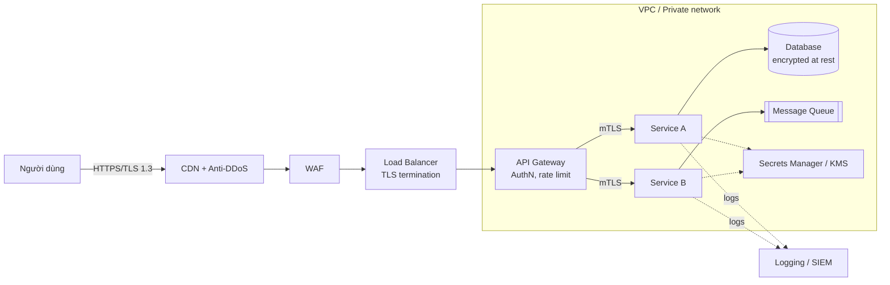
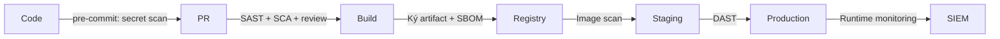

# Kiến trúc Bảo mật (Security Architecture) — Lỗ hổng, Tấn công & Phòng thủ

> Tài liệu bổ sung cho mục [Bảo mật](translations/README-vi.md#bảo-mật) của Coding Interview University.
> Phần áp dụng cho **Java Spring Boot** nằm ở [mục 15](#15-lưu-ý-trong-java-spring-boot).
> Mục tiêu: nắm được **tư duy kiến trúc bảo mật**, nhận diện **các lỗ hổng phổ biến**, hiểu **cách kẻ tấn công khai thác** ở mức khái niệm và **cách phòng thủ** — đủ để trả lời phỏng vấn và áp dụng khi thiết kế hệ thống.
>
> ⚠️ Nội dung chỉ phục vụ học tập và phòng thủ. Chỉ thực hành trên hệ thống của bạn hoặc môi trường lab hợp pháp (PortSwigger Academy, OWASP Juice Shop, DVWA, HackTheBox...).

---

## Mục lục

- [1. Nguyên tắc nền tảng](#1-nguyên-tắc-nền-tảng)
- [2. Threat Modeling — Mô hình hoá mối đe doạ](#2-threat-modeling--mô-hình-hoá-mối-đe-doạ)
- [3. Kiến trúc bảo mật theo lớp (Defense in Depth)](#3-kiến-trúc-bảo-mật-theo-lớp-defense-in-depth)
- [4. Xác thực & Phân quyền](#4-xác-thực--phân-quyền)
- [5. Mật mã học ứng dụng](#5-mật-mã-học-ứng-dụng)
- [6. OWASP Top 10 (2025)](#6-owasp-top-10-2025)
- [7. Lỗ hổng Web: Tấn công & Phòng thủ](#7-lỗ-hổng-web-tấn-công--phòng-thủ)
- [8. Lỗ hổng mức hệ thống & bộ nhớ](#8-lỗ-hổng-mức-hệ-thống--bộ-nhớ)
- [9. Tấn công mạng](#9-tấn-công-mạng)
- [10. Chuỗi cung ứng phần mềm & DevSecOps](#10-chuỗi-cung-ứng-phần-mềm--devsecops)
- [11. Giám sát, phát hiện & ứng phó sự cố](#11-giám-sát-phát-hiện--ứng-phó-sự-cố)
- [12. Bảo mật trong System Design Interview](#12-bảo-mật-trong-system-design-interview)
- [13. Câu hỏi phỏng vấn thường gặp](#13-câu-hỏi-phỏng-vấn-thường-gặp)
- [14. Checklist nhanh](#14-checklist-nhanh)
- [15. Lưu ý trong Java Spring Boot](#15-lưu-ý-trong-java-spring-boot)
- [16. Tài nguyên học thêm](#16-tài-nguyên-học-thêm)

---

## 1. Nguyên tắc nền tảng

### Bộ ba CIA

| Thuộc tính | Ý nghĩa | Bị phá vỡ bởi | Biện pháp |
|---|---|---|---|
| **Confidentiality** (Bí mật) | Chỉ người được phép mới đọc được dữ liệu | Rò rỉ dữ liệu, nghe lén | Mã hoá, phân quyền |
| **Integrity** (Toàn vẹn) | Dữ liệu không bị sửa trái phép | Giả mạo, MITM | Hash, MAC, chữ ký số |
| **Availability** (Sẵn sàng) | Hệ thống phục vụ được khi cần | DoS/DDoS, ransomware | Dự phòng, rate limit, backup |

Mở rộng: **AAA** — Authentication (bạn là ai), Authorization (bạn được làm gì), Accounting/Auditing (bạn đã làm gì). Thêm **Non-repudiation** (không thể chối bỏ — nhờ chữ ký số, audit log).

### Các nguyên tắc thiết kế (Saltzer & Schroeder và hiện đại)

- **Least Privilege** — mỗi thành phần chỉ có quyền tối thiểu cần thiết.
- **Defense in Depth** — nhiều lớp phòng thủ độc lập; một lớp thủng không làm sập toàn bộ.
- **Zero Trust** — "never trust, always verify": không tin mạng nội bộ, xác thực mọi request.
- **Secure by Default** — cấu hình mặc định phải an toàn (tắt debug, đóng port, deny-all).
- **Fail Securely** — khi lỗi thì từ chối (fail closed), không mở toang (fail open).
- **Complete Mediation** — kiểm tra quyền ở *mọi* lần truy cập, không cache quyết định một cách mù quáng.
- **Separation of Duties / Privilege Separation** — tách quyền để một tài khoản bị chiếm không đủ gây hại lớn.
- **Minimize Attack Surface** — ít endpoint, ít dependency, ít port mở.
- **Economy of Mechanism** — thiết kế đơn giản, dễ kiểm chứng.
- **Open Design** — không dựa vào việc giấu thuật toán (Kerckhoffs: chỉ khoá là bí mật).

---

## 2. Threat Modeling — Mô hình hoá mối đe doạ

Trả lời 4 câu hỏi (Adam Shostack):
1. Chúng ta đang xây gì? → vẽ Data Flow Diagram (DFD), xác định **trust boundaries**.
2. Điều gì có thể sai? → dùng **STRIDE**.
3. Chúng ta làm gì với nó? → mitigate / transfer / accept / eliminate.
4. Chúng ta làm đủ tốt chưa? → review, pentest.

### STRIDE

| Mối đe doạ | Vi phạm | Ví dụ | Phòng thủ |
|---|---|---|---|
| **S**poofing | Authentication | Giả mạo người dùng, đánh cắp session | MFA, token ký, mTLS |
| **T**ampering | Integrity | Sửa giá trong request, sửa file | Ký số, HMAC, validate phía server |
| **R**epudiation | Non-repudiation | "Tôi không hề chuyển tiền" | Audit log bất biến, chữ ký |
| **I**nformation Disclosure | Confidentiality | Lộ stack trace, lộ DB | Mã hoá, xử lý lỗi chung chung |
| **D**enial of Service | Availability | Flood request, ReDoS | Rate limit, autoscale, CDN |
| **E**levation of Privilege | Authorization | User thường gọi API admin | Kiểm tra quyền phía server, RBAC |

Đánh giá rủi ro: **Risk = Likelihood × Impact**; có thể dùng CVSS để chấm điểm lỗ hổng cụ thể.

---

## 3. Kiến trúc bảo mật theo lớp (Defense in Depth)



| Lớp | Thành phần | Chống lại |
|---|---|---|
| **Edge / Perimeter** | CDN, Anti-DDoS, WAF, DNS bảo mật | DDoS, bot, payload tấn công phổ biến |
| **Network** | VPC, subnet public/private, Security Group, NACL, firewall, VPN/bastion, mTLS | Truy cập trái phép, lateral movement, nghe lén |
| **Identity** | IdP (OIDC/SAML), MFA, IAM, service accounts | Giả mạo, chiếm tài khoản |
| **Application** | Input validation, output encoding, authZ, CSRF token, security headers | Injection, XSS, IDOR, CSRF |
| **Data** | Mã hoá at-rest (AES-256) & in-transit (TLS), KMS, tokenization, masking | Rò rỉ dữ liệu |
| **Host / Runtime** | Hardening OS, patching, container non-root, seccomp, read-only FS | Leo thang đặc quyền, escape |
| **Monitoring** | Centralized logging, SIEM, IDS/IPS, alerting | Phát hiện & điều tra |
| **Process** | Secure SDLC, code review, SAST/DAST, pentest, IR plan | Lỗi từ con người & quy trình |

### Các mẫu kiến trúc quan trọng

- **API Gateway / BFF**: điểm tập trung xác thực, rate limiting, logging. Service phía sau vẫn phải kiểm tra quyền (không tin tuyệt đối gateway).
- **Service Mesh (Istio, Linkerd)**: mTLS tự động giữa các microservice, policy service-to-service.
- **Bastion host / Zero Trust Access**: không mở SSH ra internet; truy cập qua bastion hoặc identity-aware proxy.
- **Secrets Management**: Vault, AWS Secrets Manager — không hardcode secret trong code/env file commit lên git; xoay vòng (rotate) định kỳ.
- **Envelope Encryption**: dữ liệu mã hoá bằng Data Key, Data Key mã hoá bằng Master Key trong KMS/HSM.
- **Network segmentation**: DB chỉ nhận kết nối từ app subnet; tách môi trường dev/staging/prod.

---

## 4. Xác thực & Phân quyền

### Lưu mật khẩu

- ❌ Plaintext, ❌ MD5/SHA-1/SHA-256 trần (quá nhanh → brute force bằng GPU, rainbow table).
- ✅ Dùng hàm **chậm, có salt**: **Argon2id** (khuyến nghị), bcrypt, scrypt, PBKDF2.
- Salt: ngẫu nhiên, riêng cho từng user, lưu cùng hash. **Pepper**: secret chung, lưu ngoài DB (tuỳ chọn).

```python
# ✅ Python - argon2-cffi
from argon2 import PasswordHasher
ph = PasswordHasher()
hashed = ph.hash("user_password")
ph.verify(hashed, "user_password")  # raise nếu sai
```

### Session vs Token (JWT)

| | Session (stateful) | JWT (stateless) |
|---|---|---|
| Lưu ở | Server (Redis/DB), client giữ session ID trong cookie | Client; server chỉ kiểm chữ ký |
| Thu hồi | Dễ — xoá session | Khó — cần token ngắn hạn + refresh token / denylist |
| Rủi ro | Session fixation, hijacking | `alg: none`, key yếu, lưu ở localStorage dễ bị XSS đánh cắp |

**Phòng thủ:** cookie `HttpOnly; Secure; SameSite=Lax/Strict`; tạo session ID mới sau đăng nhập; access token sống ngắn (5–15 phút); xác minh `alg`, `iss`, `aud`, `exp` của JWT; không đặt dữ liệu nhạy cảm trong payload JWT (chỉ base64, không mã hoá).

### OAuth 2.0 / OpenID Connect

- OAuth 2.0 = **ủy quyền** (authorization); OIDC = lớp **xác thực** (authentication) trên OAuth (thêm `id_token`).
- Dùng **Authorization Code + PKCE** cho cả SPA và mobile. Tránh Implicit flow.
- Kiểm tra `state` (chống CSRF), whitelist `redirect_uri` chính xác.

### Mô hình phân quyền

- **RBAC** (Role-Based): user → role → permission. Đơn giản, phổ biến.
- **ABAC** (Attribute-Based): quyết định dựa trên thuộc tính user/resource/môi trường (vd. "chỉ xem hồ sơ cùng phòng ban, trong giờ làm việc").
- **ReBAC** (Relationship-Based, kiểu Google Zanzibar): dựa trên quan hệ (owner, member, viewer).
- **Luôn kiểm tra quyền phía server**, ở tầng truy cập tài nguyên — không chỉ ẩn nút trên UI.

### Tấn công vào xác thực

| Tấn công | Mô tả | Phòng thủ |
|---|---|---|
| Brute force | Thử nhiều mật khẩu cho 1 tài khoản | Rate limit, lockout tạm thời, CAPTCHA |
| Credential stuffing | Dùng cặp user/pass rò rỉ từ site khác | MFA, phát hiện bất thường, kiểm tra mật khẩu bị lộ (HIBP) |
| Password spraying | Thử 1 mật khẩu phổ biến cho nhiều tài khoản | Chặn mật khẩu yếu, giám sát theo IP/ASN |
| Phishing | Lừa người dùng nhập thông tin | MFA chống phishing (FIDO2/WebAuthn, passkey) |
| Session hijacking | Đánh cắp cookie phiên | HttpOnly, Secure, TLS mọi nơi, ràng buộc session |
| User enumeration | Thông báo lỗi khác nhau tiết lộ user tồn tại | Thông báo lỗi chung: "Sai thông tin đăng nhập" |

---

## 5. Mật mã học ứng dụng

| Nhu cầu | Dùng | Tránh |
|---|---|---|
| Mã hoá đối xứng | AES-256-GCM, ChaCha20-Poly1305 (AEAD) | DES, 3DES, RC4, AES-ECB |
| Mã hoá bất đối xứng / trao đổi khoá | RSA ≥ 2048 (OAEP), ECDH (X25519) | RSA PKCS#1 v1.5 cho mã hoá |
| Chữ ký số | Ed25519, ECDSA P-256, RSA-PSS | |
| Hash toàn vẹn | SHA-256, SHA-3, BLAKE2/3 | MD5, SHA-1 |
| Xác thực thông điệp | HMAC-SHA256 | Hash(secret + message) — dính length extension |
| Mật khẩu | Argon2id, bcrypt, scrypt | Hash nhanh |
| Số ngẫu nhiên | CSPRNG (`secrets`, `crypto.randomBytes`, `/dev/urandom`) | `random`, `Math.random()` |
| Giao vận | TLS 1.2+/1.3, HSTS | SSL, TLS 1.0/1.1 |

**Nguyên tắc vàng:** *Đừng tự viết thuật toán mã hoá.* Dùng thư viện đã kiểm chứng (libsodium, Tink, BoringSSL). Không tái sử dụng nonce/IV với cùng khoá (GCM sẽ vỡ hoàn toàn).

**Hậu lượng tử (PQC):** NIST đã chuẩn hoá ML-KEM (Kyber) và ML-DSA (Dilithium); nhiều trình duyệt/TLS đã dùng trao đổi khoá lai X25519+ML-KEM. Biết khái niệm "harvest now, decrypt later" là điểm cộng khi phỏng vấn.

---

## 6. OWASP Top 10 (2025)

| # | Hạng mục | Tóm tắt |
|---|---|---|
| A01 | Broken Access Control | IDOR, thiếu kiểm tra quyền, SSRF (được gộp vào đây) |
| A02 | Security Misconfiguration | Cấu hình mặc định, debug bật, bucket public |
| A03 | Software Supply Chain Failures | Dependency độc hại/lỗi thời, build pipeline bị xâm nhập |
| A04 | Cryptographic Failures | Mã hoá yếu, không mã hoá, quản lý khoá kém |
| A05 | Injection | SQLi, NoSQLi, Command Injection, XSS |
| A06 | Insecure Design | Lỗi từ khâu thiết kế, thiếu threat modeling |
| A07 | Authentication Failures | Xác thực yếu, session kém |
| A08 | Software or Data Integrity Failures | Deserialization không an toàn, update không ký |
| A09 | Security Logging & Alerting Failures | Không log, không cảnh báo |
| A10 | Mishandling of Exceptional Conditions | Xử lý lỗi sai → fail open, lộ thông tin |

So với bản 2021: Supply Chain và Exceptional Conditions là hạng mục mới; SSRF được gộp vào Broken Access Control.

---

## 7. Lỗ hổng Web: Tấn công & Phòng thủ

### 7.1 SQL Injection

**Nguyên nhân:** ghép chuỗi input người dùng trực tiếp vào câu truy vấn.

**Cách tấn công (khái niệm):** input chứa ký tự đặc biệt của SQL (`'`, `--`, `OR 1=1`) làm thay đổi logic truy vấn → bỏ qua đăng nhập, đọc bảng khác (UNION), hoặc suy luận dữ liệu qua phản hồi đúng/sai hay thời gian trễ (blind SQLi).

```python
# ❌ Dễ bị tấn công
cursor.execute(f"SELECT * FROM users WHERE email = '{email}'")

# ✅ Parameterized query / prepared statement
cursor.execute("SELECT * FROM users WHERE email = %s", (email,))
```

**Phòng thủ:** prepared statements / ORM đúng cách; whitelist cho tên cột/ORDER BY; tài khoản DB quyền tối thiểu; WAF như lớp phụ.

### 7.2 Cross-Site Scripting (XSS)

**Loại:** Stored (lưu trong DB), Reflected (phản hồi từ URL), DOM-based (JS phía client xử lý sai).

**Cách tấn công:** chèn script vào nội dung mà trang hiển thị cho người khác → script chạy trong origin của nạn nhân → đánh cắp token, thực hiện hành động thay nạn nhân.

```javascript
// ❌ Chèn HTML thô
el.innerHTML = userComment;

// ✅ Chèn như text
el.textContent = userComment;
```

**Phòng thủ:**
- **Output encoding theo ngữ cảnh** (HTML, attribute, JS, URL). Framework hiện đại (React, Angular, Vue) tự escape — cẩn thận với `dangerouslySetInnerHTML`, `v-html`.
- Sanitize HTML khi bắt buộc cho phép HTML (DOMPurify).
- **Content Security Policy**: `Content-Security-Policy: default-src 'self'; script-src 'self' 'nonce-...'`.
- Cookie `HttpOnly` để script không đọc được session.

### 7.3 Cross-Site Request Forgery (CSRF)

**Cách tấn công:** nạn nhân đang đăng nhập site A; truy cập trang độc hại tự gửi request (form) tới site A → trình duyệt tự đính kèm cookie → hành động được thực hiện thay nạn nhân.

**Phòng thủ:** cookie `SameSite=Lax/Strict`; anti-CSRF token (synchronizer token / double-submit cookie); kiểm tra `Origin`/`Referer`; không dùng GET cho thao tác thay đổi trạng thái; yêu cầu xác nhận lại cho hành động nhạy cảm.

### 7.4 Broken Access Control / IDOR

**Cách tấn công:** đổi ID trong request (`GET /api/invoices/1001` → `1002`) để xem dữ liệu người khác; gọi trực tiếp endpoint admin bị ẩn trên UI; sửa trường `role` trong body (mass assignment).

```python
# ❌
invoice = Invoice.get(id=invoice_id)

# ✅ Luôn ràng buộc với chủ sở hữu
invoice = Invoice.get(id=invoice_id, owner_id=current_user.id)
```

**Phòng thủ:** deny by default; kiểm tra quyền ở server cho mọi request; dùng DTO/whitelist trường cho phép cập nhật; ID khó đoán (UUID) chỉ là lớp phụ, *không* thay thế kiểm tra quyền; test tự động cho authorization.

### 7.5 Server-Side Request Forgery (SSRF)

**Cách tấn công:** tính năng "tải ảnh từ URL", webhook... bị lợi dụng để server gửi request tới tài nguyên nội bộ (`localhost`, IP private, cloud metadata `169.254.169.254`) → lộ credential cloud, quét mạng nội bộ.

**Phòng thủ:** allowlist domain/scheme; resolve DNS rồi chặn IP private/link-local (và chống DNS rebinding bằng cách kết nối tới IP đã kiểm tra); dùng IMDSv2 trên AWS; tách egress proxy; không trả nguyên response cho client.

### 7.6 Command Injection & Path Traversal

- **Command Injection:** input được đưa vào shell (`os.system("ping " + host)`) → ký tự `;`, `&&`, `|` cho phép chạy lệnh khác.
  **Phòng thủ:** tránh shell; dùng API với danh sách tham số (`subprocess.run(["ping", "-c", "1", host])`), validate chặt.
- **Path Traversal:** `../` trong tên file để đọc file ngoài thư mục cho phép.
  **Phòng thủ:** chuẩn hoá đường dẫn (`realpath`) rồi kiểm tra vẫn nằm trong thư mục gốc; dùng ID thay vì tên file người dùng nhập.

### 7.7 Insecure Deserialization & XXE

- **Deserialization:** giải tuần tự hoá dữ liệu không tin cậy bằng `pickle`, Java native serialization, PHP `unserialize`... có thể dẫn tới thực thi mã (gadget chains).
  **Phòng thủ:** dùng định dạng dữ liệu thuần (JSON) + schema validation; ký/kiểm tra toàn vẹn; không deserialize dữ liệu từ client.
- **XXE (XML External Entity):** parser XML xử lý entity ngoài → đọc file, SSRF.
  **Phòng thủ:** tắt DTD/external entity trong parser (`defusedxml` cho Python).

### 7.8 Các lỗ hổng web khác

| Lỗ hổng | Tấn công | Phòng thủ |
|---|---|---|
| Clickjacking | Nhúng site vào iframe trong suốt để lừa click | `X-Frame-Options: DENY` / CSP `frame-ancestors 'none'` |
| Open Redirect | `?next=https://evil.com` dùng cho phishing | Allowlist đích chuyển hướng, chỉ cho phép đường dẫn tương đối |
| CORS sai cấu hình | `Access-Control-Allow-Origin` phản chiếu mọi origin + credentials | Allowlist origin cụ thể |
| Race condition / TOCTOU | Gửi đồng thời nhiều request để dùng mã giảm giá nhiều lần | Transaction, khoá, ràng buộc unique, idempotency key |
| ReDoS | Regex backtracking theo hàm mũ với input xấu | Regex an toàn/engine tuyến tính (RE2), giới hạn độ dài input |
| HTTP Request Smuggling | Proxy và backend hiểu ranh giới request khác nhau | Chuẩn hoá HTTP, dùng HTTP/2 end-to-end, cập nhật proxy |
| Business logic flaws | Số lượng âm, bỏ qua bước thanh toán | Kiểm tra logic phía server, threat modeling |

### Security Headers nên có

```
Strict-Transport-Security: max-age=63072000; includeSubDomains; preload
Content-Security-Policy: default-src 'self'; frame-ancestors 'none'
X-Content-Type-Options: nosniff
Referrer-Policy: strict-origin-when-cross-origin
Permissions-Policy: camera=(), microphone=(), geolocation=()
```

---

## 8. Lỗ hổng mức hệ thống & bộ nhớ

### Buffer Overflow & lỗi an toàn bộ nhớ

**Nguyên nhân:** ngôn ngữ không kiểm tra biên (C/C++) — ghi vượt kích thước buffer (`strcpy`, `gets`), use-after-free, double free, integer overflow dẫn tới cấp phát sai kích thước.

**Cách tấn công (khái niệm):** ghi đè dữ liệu điều khiển trên stack/heap (vd. return address) để chuyển hướng luồng thực thi — đây là chủ đề "Control Hijacking" trong khoá MIT 6.858.

**Phòng thủ (nhiều lớp):**

| Kỹ thuật | Tác dụng |
|---|---|
| Ngôn ngữ memory-safe (Rust, Go, Java, C#) | Loại bỏ cả lớp lỗi từ gốc |
| Hàm an toàn (`strncpy`, `snprintf`), kiểm tra biên | Giảm lỗi ghi vượt |
| **Stack Canary** | Phát hiện stack bị ghi đè trước khi return |
| **DEP / NX bit** | Vùng dữ liệu không được thực thi |
| **ASLR** | Ngẫu nhiên hoá địa chỉ → khó đoán đích nhảy |
| **CFI / Shadow Stack (CET)** | Đảm bảo luồng điều khiển hợp lệ |
| Fuzzing (AFL++, libFuzzer), sanitizers (ASan, UBSan) | Tìm lỗi trước khi phát hành |

### Leo thang đặc quyền & Sandboxing

- **Privilege escalation:** từ user thường → root qua SUID binary lỗi, kernel exploit, cấu hình sudo sai, file quyền ghi lỏng lẻo.
- **Phòng thủ:** patch thường xuyên; chạy service bằng user riêng không đặc quyền; container chạy non-root, drop capabilities, seccomp/AppArmor/SELinux; sandbox (Chrome site isolation, gVisor, Firecracker microVM).

### Side-channel attacks

- **Timing attack:** so sánh chuỗi bí mật bằng `==` dừng sớm ở ký tự sai đầu tiên → đo thời gian để đoán dần.
  ```python
  import hmac
  hmac.compare_digest(expected_token, provided_token)  # ✅ constant-time
  ```
- **Spectre/Meltdown:** khai thác thực thi suy đoán của CPU để đọc bộ nhớ ngoài quyền. Phòng thủ: microcode, kernel page-table isolation, site isolation trên trình duyệt.

---

## 9. Tấn công mạng

| Tấn công | Mô tả | Phòng thủ |
|---|---|---|
| **MITM** | Kẻ trung gian nghe lén/sửa traffic (Wi-Fi giả, ARP spoofing) | TLS mọi nơi, HSTS, certificate pinning (mobile), mTLS nội bộ |
| **DNS spoofing / cache poisoning** | Trả bản ghi DNS giả | DNSSEC, DoH/DoT, resolver tin cậy |
| **DoS / DDoS** | Làm cạn tài nguyên: volumetric (băng thông), protocol (SYN flood), application layer (HTTP flood) | CDN/Anti-DDoS (Cloudflare, AWS Shield), SYN cookies, rate limiting, autoscaling, cache |
| **Port scanning / reconnaissance** | Dò dịch vụ mở | Đóng port thừa, firewall, IDS |
| **Lateral movement** | Từ 1 máy bị chiếm lan sang máy khác | Network segmentation, Zero Trust, EDR |
| **BGP hijacking** | Chiếm tuyến định tuyến IP | RPKI (tầng nhà mạng) |

### TLS handshake (TLS 1.3) — câu hỏi phỏng vấn kinh điển

1. Client gửi `ClientHello` (cipher suites, key share).
2. Server trả `ServerHello` + key share + chứng chỉ + chữ ký → cả hai suy ra khoá phiên bằng (EC)DHE → **Forward Secrecy**.
3. Client xác minh chứng chỉ qua chuỗi CA, kiểm tra tên miền, hạn dùng.
4. Dữ liệu ứng dụng được mã hoá bằng khoá đối xứng (AEAD). TLS 1.3 chỉ cần 1-RTT (0-RTT cho session resume, có rủi ro replay).

---

## 10. Chuỗi cung ứng phần mềm & DevSecOps

**Tấn công:** typosquatting package (`reqeusts`), dependency confusion (package public trùng tên package nội bộ), chiếm tài khoản maintainer, chèn mã vào pipeline build (kiểu SolarWinds, xz-utils backdoor 2024).

**Phòng thủ:**
- Lock file + kiểm tra hash; pin version; registry nội bộ/proxy có scope.
- SCA (Dependabot, Snyk, `npm audit`, OSV-Scanner); **SBOM** (CycloneDX, SPDX).
- Ký artifact (Sigstore/cosign), framework **SLSA** cho tính toàn vẹn build.
- CI/CD: secret quản lý tập trung, quyền token tối thiểu, branch protection, review bắt buộc.
- **Shift left:** SAST (Semgrep, CodeQL), DAST (OWASP ZAP), secret scanning (gitleaks), IaC scanning (Checkov, tfsec), container scanning (Trivy).



---

## 11. Giám sát, phát hiện & ứng phó sự cố

- **Log gì:** đăng nhập thành công/thất bại, thay đổi quyền, truy cập dữ liệu nhạy cảm, lỗi authZ, thay đổi cấu hình.
- **Không log:** mật khẩu, token, số thẻ, dữ liệu cá nhân không cần thiết.
- Log tập trung, chống sửa xoá (append-only/WORM), đồng bộ thời gian (NTP).
- **SIEM** để tương quan sự kiện và cảnh báo; **IDS/IPS**, **EDR** trên máy chủ.
- **Quy trình ứng phó sự cố (NIST):** Chuẩn bị → Phát hiện & Phân tích → Ngăn chặn, Loại bỏ & Khôi phục → Rút kinh nghiệm (post-mortem).
- **Backup 3-2-1** (3 bản, 2 loại phương tiện, 1 bản offsite/offline) chống ransomware; thử khôi phục định kỳ.

---

## 12. Bảo mật trong System Design Interview

Khi thiết kế bất kỳ hệ thống nào (URL shortener, chat, payment...), dành 3–5 phút cho bảo mật:

1. **Xác thực & phân quyền:** OIDC/JWT ngắn hạn, kiểm tra quyền ở từng service.
2. **Dữ liệu:** phân loại dữ liệu nhạy cảm; mã hoá in-transit (TLS/mTLS) và at-rest (KMS); tokenization cho dữ liệu thẻ (PCI DSS).
3. **Biên mạng:** CDN + WAF + rate limit ở gateway; service nội bộ trong private subnet.
4. **Lạm dụng:** chống spam/bot, rate limit theo user/IP/API key, idempotency key cho thanh toán.
5. **Bí mật:** secrets manager, xoay vòng khoá.
6. **Quan sát:** audit log, cảnh báo bất thường.
7. **Tuân thủ:** GDPR, PCI DSS, Nghị định 13/2023/NĐ-CP (bảo vệ dữ liệu cá nhân tại Việt Nam) — data retention, quyền xoá dữ liệu.

**Ví dụ nhanh — URL Shortener:** chống open redirect/phishing (quét URL đích với Safe Browsing), rate limit tạo link, mã ngắn ngẫu nhiên để không bị liệt kê, trang preview cho link đáng ngờ.

---

## 13. Câu hỏi phỏng vấn thường gặp

<details>
<summary>1. Khác nhau giữa mã hoá, hash và encoding?</summary>

- **Encoding** (Base64, URL encoding): biểu diễn lại dữ liệu, không có bí mật, đảo ngược tự do.
- **Hash**: một chiều, kích thước cố định, dùng kiểm tra toàn vẹn/lưu mật khẩu (với hàm chậm + salt).
- **Encryption**: hai chiều, cần khoá để giải mã, bảo đảm bí mật.
</details>

<details>
<summary>2. Mã hoá đối xứng vs bất đối xứng? TLS dùng cái nào?</summary>

Đối xứng: 1 khoá, nhanh (AES). Bất đối xứng: cặp khoá công khai/bí mật, chậm, dùng cho trao đổi khoá và chữ ký. TLS dùng **cả hai**: bất đối xứng (ECDHE + chứng chỉ) để thống nhất khoá phiên, đối xứng (AES-GCM) để mã hoá dữ liệu.
</details>

<details>
<summary>3. XSS và CSRF khác nhau thế nào?</summary>

XSS: kẻ tấn công **chạy được script** trong origin của nạn nhân (khai thác niềm tin của người dùng vào site). CSRF: kẻ tấn công **khiến trình duyệt gửi request** đã xác thực mà không cần đọc phản hồi (khai thác niềm tin của site vào trình duyệt). Có XSS thì mọi biện pháp chống CSRF đều bị vượt qua.
</details>

<details>
<summary>4. Tại sao không lưu JWT trong localStorage?</summary>

Mọi script trong trang (kể cả script do XSS chèn vào) đều đọc được localStorage. Cookie `HttpOnly` không đọc được từ JS. Đánh đổi: dùng cookie thì phải chống CSRF (SameSite + token).
</details>

<details>
<summary>5. Salt là gì, tại sao cần?</summary>

Chuỗi ngẫu nhiên riêng cho mỗi mật khẩu, ghép trước khi hash. Ngăn rainbow table và khiến hai user cùng mật khẩu có hash khác nhau → kẻ tấn công phải bẻ từng hash riêng.
</details>

<details>
<summary>6. Thiết kế rate limiter chống brute force?</summary>

Token bucket / sliding window, lưu bộ đếm trong Redis, key theo (user, IP). Kết hợp exponential backoff, CAPTCHA sau N lần sai, cảnh báo khi vượt ngưỡng. Lưu ý không để lockout bị lợi dụng làm DoS tài khoản người khác.
</details>

<details>
<summary>7. Một request đi từ trình duyệt đến DB, liệt kê các điểm kiểm soát bảo mật?</summary>

DNS (DNSSEC) → TLS/HSTS → CDN/Anti-DDoS → WAF → LB → API Gateway (authN, rate limit) → Service (authZ, validation, parameterized query) → DB (tài khoản quyền tối thiểu, mã hoá at-rest, private subnet) → logging ở mọi bước.
</details>

<details>
<summary>8. Forward secrecy là gì?</summary>

Dùng khoá tạm thời (ephemeral DH) cho mỗi phiên, nên nếu khoá bí mật dài hạn của server bị lộ sau này thì traffic đã ghi lại trước đó vẫn không giải mã được.
</details>

<details>
<summary>9. Phát hiện secret bị commit lên Git thì làm gì?</summary>

**Thu hồi/xoay vòng secret ngay lập tức** (coi như đã lộ), kiểm tra log xem đã bị dùng chưa, sau đó mới xoá khỏi lịch sử git (git filter-repo/BFG) và thêm secret scanning vào pre-commit/CI.
</details>

<details>
<summary>10. Zero Trust khác mô hình perimeter truyền thống ra sao?</summary>

Perimeter: "trong mạng nội bộ là tin cậy" (castle-and-moat) → một máy bị chiếm là lan khắp nơi. Zero Trust: xác thực & phân quyền mọi request dựa trên danh tính thiết bị/người dùng/ngữ cảnh, mTLS giữa service, micro-segmentation, quyền tối thiểu theo thời gian.
</details>

---

## 14. Checklist nhanh

- [ ] Threat model (STRIDE) cho tính năng mới
- [ ] HTTPS mọi nơi, TLS 1.2+, HSTS
- [ ] Mật khẩu hash bằng Argon2id/bcrypt; hỗ trợ MFA/passkey
- [ ] Kiểm tra quyền phía server cho mọi endpoint (deny by default)
- [ ] Parameterized queries; không ghép chuỗi SQL/shell
- [ ] Output encoding + CSP chống XSS
- [ ] Cookie `HttpOnly; Secure; SameSite`
- [ ] Rate limiting & chống bot
- [ ] Secrets trong secrets manager, không nằm trong git
- [ ] Dependency được quét, có SBOM, lock file
- [ ] Mã hoá dữ liệu nhạy cảm at-rest; quản lý khoá bằng KMS
- [ ] Thông báo lỗi chung chung, không lộ stack trace
- [ ] Logging & alerting cho sự kiện bảo mật; không log dữ liệu nhạy cảm
- [ ] Container non-root, image tối giản, patch thường xuyên
- [ ] Backup 3-2-1 và đã thử khôi phục
- [ ] Kế hoạch ứng phó sự cố

---

## 15. Lưu ý trong Java Spring Boot

> Áp dụng cho **Spring Boot 3.x / 4.x** (Spring Security 6/7, Java 17+). Phần cơ chế filter chain, JWT, OAuth2/OIDC đã có ở [`SpringBoot.md` – mục 9](SpringBoot.md#9-spring-security-architecture--jwt-stateless-flow); phần này đi theo **từng lỗ hổng** ở trên và chỉ ra chỗ Spring Boot hay bị dùng sai.

### 15.0. Bản đồ nhanh: lỗ hổng → điểm cần chú ý trong Spring

| Lỗ hổng | Chỗ hay sai trong Spring Boot | Mục |
|---|---|---|
| Injection (SQL/JPQL/SpEL) | Ghép chuỗi trong `createQuery`, `JdbcTemplate`, `@Query(nativeQuery)`, sort động; parse SpEL từ input | 15.1, 15.11 |
| Broken Access Control / IDOR | Chỉ chặn theo URL, quên kiểm tra chủ sở hữu; bind thẳng `@Entity` từ `@RequestBody` (mass assignment); self-invocation bỏ qua `@PreAuthorize` | 15.2 |
| XSS | `th:utext` trong Thymeleaf; tắt security headers | 15.3 |
| CSRF / CORS | `csrf.disable()` khi vẫn dùng cookie; `allowedOrigins("*")` + credentials | 15.4 |
| Authentication Failures | Không rate limit login; JWT không kiểm tra `aud`; secret HS256 ngắn | 15.5 |
| Cryptographic Failures | `Cipher.getInstance("AES")` (= ECB); secret trong `application.yml` | 15.6 |
| Security Misconfiguration | Lộ Actuator (`/heapdump`, `/env`), H2 console, Swagger ở prod | 15.7 |
| SSRF | `RestClient`/`WebClient` gọi URL do người dùng nhập | 15.8 |
| Deserialization / XXE | Jackson default typing, `JsonDeserializer` trust `*`, `ObjectInputStream`, parser XML mặc định | 15.9 |
| Path traversal / Upload | Tin `getOriginalFilename()` | 15.10 |
| Logging & Alerting | Log token/mật khẩu, không có audit event | 15.12 |
| DoS | Không giới hạn page size, body, độ sâu JSON | 15.13 |
| Race condition | Check-then-act không khoá | 15.14 |
| Supply chain | Dependency lỗi thời (Log4Shell, Spring4Shell) | 15.15 |

### 15.0.1. Khung cấu hình an toàn mặc định

```java
@Configuration
@EnableWebSecurity
@EnableMethodSecurity               // bật @PreAuthorize / @PostAuthorize
public class SecurityConfig {

    @Bean
    SecurityFilterChain api(HttpSecurity http) throws Exception {
        return http
            .securityMatcher("/api/**")
            .authorizeHttpRequests(auth -> auth
                // Rule cụ thể đặt TRƯỚC, rule chung đặt SAU — khớp rule đầu tiên là dừng
                .requestMatchers(HttpMethod.POST, "/api/v1/auth/login").permitAll()
                .requestMatchers("/api/v1/admin/**").hasRole("ADMIN")
                .anyRequest().authenticated()          // deny by default: KHÔNG kết thúc bằng permitAll()
            )
            .oauth2ResourceServer(o -> o.jwt(Customizer.withDefaults()))
            .sessionManagement(s -> s.sessionCreationPolicy(SessionCreationPolicy.STATELESS))
            .csrf(c -> c.disable())                    // chỉ vì token đi qua header Authorization (xem 15.4)
            .headers(h -> h
                .contentSecurityPolicy(csp -> csp.policyDirectives("default-src 'none'; frame-ancestors 'none'"))
                .httpStrictTransportSecurity(hsts -> hsts.includeSubDomains(true).maxAgeInSeconds(31536000))
            )
            .build();
    }
}
```

- Spring Security **mặc định đã bật**: CSRF, `X-Content-Type-Options: nosniff`, `X-Frame-Options: DENY`, `Cache-Control: no-store`, HSTS (chỉ gửi trên HTTPS), chống session fixation. Đừng tắt những thứ này "cho chạy được".
- Nếu `spring-boot-starter-security` có trên classpath mà bạn **chưa** khai báo `SecurityFilterChain`, Boot tự bảo vệ mọi URL bằng form/basic login với mật khẩu sinh ngẫu nhiên in ra log — chỉ dùng khi dev.

---

### 15.1. Injection: SQL / JPQL / NoSQL

```java
// ❌ Ghép chuỗi — JPQL injection vẫn là injection
em.createQuery("SELECT u FROM User u WHERE u.email = '" + email + "'");
jdbcTemplate.query("SELECT * FROM users WHERE name = '" + name + "'", mapper);

// ✅ Tham số hoá
em.createQuery("SELECT u FROM User u WHERE u.email = :email", User.class)
  .setParameter("email", email);
jdbcTemplate.query("SELECT * FROM users WHERE name = ?", mapper, name);

@Query(value = "SELECT * FROM orders WHERE status = :status", nativeQuery = true)
List<Order> findByStatus(@Param("status") String status);
```

- **Derived query** (`findByEmail`), **Specification / Criteria API**, `@Query` với `:param` hoặc `?1` đều an toàn — miễn là bạn **không tự nối chuỗi**.
- **Sắp xếp & tên cột động không tham số hoá được** → whitelist:
  ```java
  private static final Set<String> SORTABLE = Set.of("createdAt", "price", "name");
  if (!SORTABLE.contains(sortField)) throw new BadRequestException("Invalid sort");
  ```
  Không dùng `JpaSort.unsafe(userInput)`; trong native query, đừng nối `ORDER BY` từ input.
- **Spring Data MongoDB**: dùng `Criteria.where("name").is(name)` hoặc `@Query("{ 'name': ?0 }")`; không build chuỗi JSON truy vấn bằng tay, và không bind thẳng `Map`/`Document` từ request vào điều kiện truy vấn (operator injection kiểu `{"$ne": null}`).
- Tài khoản DB của ứng dụng chỉ cần quyền DML; quyền DDL để cho Flyway/Liquibase với tài khoản riêng.

### 15.2. Broken Access Control, IDOR & Mass Assignment

**Kiểm tra quyền sở hữu, không chỉ kiểm tra role:**

```java
// ✅ Cách 1: ràng buộc chủ sở hữu ngay trong truy vấn
Order order = orderRepository.findByIdAndOwnerId(id, currentUserId)
        .orElseThrow(() -> new NotFoundException());   // trả 404 thay vì 403 để không lộ sự tồn tại

// ✅ Cách 2: method security gọi một bean kiểm tra quyền
@PreAuthorize("@orderAuthz.canRead(#id, authentication)")
public OrderDto getOrder(Long id) { ... }

// ✅ Cách 3: kiểm tra trên kết quả trả về
@PostAuthorize("returnObject.ownerId == authentication.name")
public OrderDto getOrder(Long id) { ... }
```

**Cạm bẫy riêng của Spring:**
- **Self-invocation:** `@PreAuthorize` chạy qua AOP proxy → method trong cùng class gọi nhau sẽ **bỏ qua kiểm tra quyền** (giống `@Transactional`, xem `SpringBoot.md` 4.3). Đặt annotation ở method public được gọi từ bean khác.
- **Thứ tự `requestMatchers`:** `.requestMatchers("/api/**").authenticated()` đặt trước `/api/admin/**` sẽ khiến rule admin không bao giờ được xét.
- **Nhiều `SecurityFilterChain`:** chain đầu tiên có `securityMatcher` khớp sẽ xử lý; chain thiếu `securityMatcher` khớp mọi request. Kiểm tra `@Order`.
- **Mass assignment:** đừng nhận `@Entity` trực tiếp từ `@RequestBody`.
  ```java
  // ❌ Client gửi thêm "role":"ADMIN", "balance":1000000 → được lưu luôn
  @PutMapping("/me") public User update(@RequestBody User user) { return repo.save(user); }

  // ✅ DTO chỉ chứa trường được phép sửa
  public record UpdateProfileRequest(@NotBlank @Size(max = 100) String displayName,
                                     @Email String email) {}
  ```
  Với form binding (`@ModelAttribute`), dùng `@InitBinder` + `binder.setAllowedFields(...)`.
- **Spring Data REST** tự expose mọi repository thành endpoint CRUD → nếu dùng, chặn bằng `@RepositoryRestResource(exported = false)` và method security trên repository.

### 15.3. XSS

- REST API trả JSON (`Content-Type: application/json`) → trình duyệt không render như HTML; XSS chủ yếu xảy ra ở **frontend** hoặc **server-side template**.
- **Thymeleaf:** `th:text` tự escape ✅ — `th:utext` **không** escape ❌. Chỉ dùng `th:utext` với HTML đã sanitize.
- Khi bắt buộc cho phép HTML (rich text editor), sanitize ở server bằng **OWASP Java HTML Sanitizer**:
  ```java
  PolicyFactory policy = Sanitizers.FORMATTING.and(Sanitizers.LINKS);
  String safeHtml = policy.sanitize(untrustedHtml);
  ```
- Bật **CSP** qua `headers().contentSecurityPolicy(...)` (xem 15.0.1). Không trả thông báo lỗi chứa input người dùng chưa escape.

### 15.4. CSRF, CORS & Cookie

**CSRF — khi nào được tắt:**

| Kiểu xác thực | CSRF |
|---|---|
| Bearer token trong header `Authorization` (mobile, service-to-service, SPA giữ token trong bộ nhớ) | Có thể tắt |
| Session cookie / JWT trong cookie (web truyền thống, SPA dùng cookie, BFF) | **Phải bật** |

- SPA dùng cookie: dùng `CookieCsrfTokenRepository.withHttpOnlyFalse()` để JS đọc được cookie `XSRF-TOKEN` và gửi lại header `X-XSRF-TOKEN`. Từ Spring Security 6, token mặc định được "mask" (chống BREACH) nên SPA cần cấu hình `CsrfTokenRequestHandler` phù hợp — đọc mục *CSRF → Single-Page Applications* trong tài liệu Spring Security đúng phiên bản bạn dùng.
- Cookie session:
  ```yaml
  server.servlet.session.cookie:
    http-only: true
    secure: true
    same-site: lax     # hoặc strict
  ```

**CORS:**
```java
@Bean
CorsConfigurationSource corsConfigurationSource() {
    var cfg = new CorsConfiguration();
    cfg.setAllowedOrigins(List.of("https://app.example.com"));   // ❌ không "*" khi allowCredentials = true
    cfg.setAllowedMethods(List.of("GET", "POST", "PUT", "DELETE"));
    cfg.setAllowedHeaders(List.of("Authorization", "Content-Type"));
    cfg.setAllowCredentials(true);
    var src = new UrlBasedCorsConfigurationSource();
    src.registerCorsConfiguration("/api/**", cfg);
    return src;
}
// và http.cors(Customizer.withDefaults()) để CORS chạy TRƯỚC filter xác thực (preflight không bị 401)
```
- Cẩn thận `allowedOriginPatterns("https://*.example.com")` nếu có subdomain do người khác kiểm soát. Tránh rải `@CrossOrigin("*")` trên controller.

### 15.5. Authentication Failures

- **Mã hoá mật khẩu:** `PasswordEncoderFactories.createDelegatingPasswordEncoder()` (mặc định bcrypt, lưu dạng `{bcrypt}...` để nâng cấp dần) hoặc `Argon2PasswordEncoder.defaultsForSpringSecurity_v5_8()` (cần BouncyCastle). Không dùng `NoOpPasswordEncoder` hay `StandardPasswordEncoder` (đã deprecated).
- **Brute force / credential stuffing:** Spring Security **không có sẵn** rate limit hay lockout → tự thêm:
  - Rate limit ở API Gateway, hoặc **Bucket4j** / Resilience4j `RateLimiter` theo IP + username cho endpoint login.
  - Lắng nghe `AuthenticationFailureBadCredentialsEvent` / `AuthenticationSuccessEvent` để đếm lần sai, khoá tạm thời (`UserDetails.isAccountNonLocked()`), cảnh báo.
- **User enumeration:** `DaoAuthenticationProvider` mặc định `hideUserNotFoundExceptions = true` — giữ nguyên; endpoint "quên mật khẩu" luôn trả cùng một thông báo.
- **JWT với Resource Server:**
  ```yaml
  spring.security.oauth2.resourceserver.jwt:
    issuer-uri: https://auth.example.com/realms/demo
    audiences: orders-api        # mặc định Spring KHÔNG kiểm tra aud → token cấp cho service khác vẫn dùng được
  ```
  Nếu tự phát JWT: cố định thuật toán khi tạo `NimbusJwtDecoder` (`.macAlgorithm(MacAlgorithm.HS256)` hoặc `.signatureAlgorithm(...)`), secret HS256 tối thiểu 256 bit sinh bằng `SecureRandom`, access token 5–15 phút, refresh token có rotation (xem `SpringBoot.md` 9.3).
- **Session:** chống session fixation đã bật mặc định (`changeSessionId`); giới hạn phiên đồng thời bằng `sessionManagement(s -> s.maximumSessions(1))` nếu nghiệp vụ cần.
- **MFA / Passkey:** Spring Security 6.4+ hỗ trợ **WebAuthn / Passkeys** (`http.webAuthn(...)`) và One-Time Token login; hoặc giao MFA cho IdP (Keycloak, Okta...).

### 15.6. Cryptographic Failures & quản lý Secret

```java
// ❌ "AES" mặc định = AES/ECB/PKCS5Padding → khối giống nhau cho ra ciphertext giống nhau
Cipher c = Cipher.getInstance("AES");

// ✅ AES-GCM, IV 12 byte ngẫu nhiên, KHÔNG tái sử dụng IV với cùng khoá
byte[] iv = new byte[12];
new SecureRandom().nextBytes(iv);
Cipher c = Cipher.getInstance("AES/GCM/NoPadding");
c.init(Cipher.ENCRYPT_MODE, key, new GCMParameterSpec(128, iv));
```
- Số ngẫu nhiên cho token/OTP: `SecureRandom`, không dùng `java.util.Random` / `Math.random()`. So sánh MAC/token: `MessageDigest.isEqual(a, b)` (constant-time), không dùng `Arrays.equals` / `String.equals`.
- Ưu tiên API cấp cao: **Spring Security Crypto** (`Encryptors.stronger(password, salt)` dùng AES-GCM) hoặc **Google Tink** thay vì tự ghép `Cipher`.
- **Secret không nằm trong `application.yml` commit lên Git.** Dùng biến môi trường, K8s Secret, hoặc `spring.config.import`:
  ```yaml
  spring.config.import: "optional:vault://"     # Spring Cloud Vault
  # hoặc "aws-secretsmanager:prod/orders-db"    # Spring Cloud AWS
  ```
  Jasypt (mã hoá giá trị trong file config) chỉ dời bài toán sang "giữ master password ở đâu" — chấp nhận được cho hệ thống nhỏ, không thay thế secrets manager.
- **TLS:** cấu hình qua **SSL Bundles** (`spring.ssl.bundle.*`, Boot 3.1+) cho server, `RestClient`, kết nối DB/Redis/Kafka; mTLS giữa service nếu không có service mesh. Không bao giờ dùng `TrustManager` chấp nhận mọi chứng chỉ "cho tiện".

### 15.7. Security Misconfiguration — Actuator & môi trường production

**Actuator là cửa hậu phổ biến nhất của Spring Boot:**

| Endpoint | Rủi ro nếu lộ |
|---|---|
| `/actuator/heapdump` | Dump toàn bộ heap → chứa mật khẩu DB, token, dữ liệu người dùng **ở dạng rõ** |
| `/actuator/env`, `/configprops` | Lộ cấu hình (giá trị được che theo mặc định, nhưng đừng dựa vào đó) |
| `/actuator/loggers` (POST) | Đổi log level → bật DEBUG làm lộ dữ liệu / tràn đĩa |
| `/actuator/threaddump`, `/mappings`, `/beans` | Lộ cấu trúc nội bộ, hỗ trợ trinh sát |
| `/actuator/shutdown` | Tắt ứng dụng (DoS) |

```yaml
# application-prod.yml
management:
  server.port: 8081                         # cổng riêng, chỉ mở trong mạng nội bộ
  endpoints.web.exposure.include: health,info,prometheus
  endpoint:
    health.show-details: never              # hoặc when-authorized
    heapdump.access: none                   # Boot 3.4+; bản cũ: management.endpoint.heapdump.enabled=false

server:
  error:
    include-stacktrace: never               # mặc định never — đừng đổi thành always ở prod
    include-message: never
    include-binding-errors: never

spring:
  h2.console.enabled: false
  jpa.show-sql: false
  jpa.open-in-view: false
springdoc:
  api-docs.enabled: false                   # tắt Swagger/OpenAPI ở prod (hoặc bảo vệ bằng auth)
  swagger-ui.enabled: false
```
- Endpoint actuator ngoài `health` phải nằm sau xác thực (`EndpointRequest.toAnyEndpoint()` + `hasRole("OPS")`).
- **DevTools** tự bị loại khỏi fat JAR khi build bằng plugin Boot — đừng ép đưa vào image production.
- Xử lý lỗi tập trung bằng `@RestControllerAdvice` + `ProblemDetail` (RFC 9457): trả thông báo chung, log chi tiết ở server kèm trace ID.
- Container: chạy JVM bằng user non-root, image tối giản (distroless, hoặc `bootBuildImage` với Paketo).

### 15.8. SSRF

Mọi chỗ `RestClient`, `WebClient`, `RestTemplate` nhận URL (hoặc host) từ người dùng — webhook, "import từ URL", preview link — đều là điểm SSRF.

```java
private static final Set<String> ALLOWED_HOSTS = Set.of("api.partner.com", "cdn.example.com");

URI uri = URI.create(userUrl);
if (!"https".equals(uri.getScheme()) || !ALLOWED_HOSTS.contains(uri.getHost())) {
    throw new BadRequestException("URL not allowed");
}
// Nếu không thể dùng allowlist: resolve DNS và chặn IP nội bộ
for (InetAddress a : InetAddress.getAllByName(uri.getHost())) {
    if (a.isLoopbackAddress() || a.isSiteLocalAddress() || a.isLinkLocalAddress()
        || a.isAnyLocalAddress()) throw new BadRequestException("Internal address");
}
```
- **Tắt tự động follow redirect** cho client gọi URL ngoài (redirect có thể dẫn vào `169.254.169.254`), hoặc kiểm tra lại từng bước. Với JDK `HttpClient`: `.followRedirects(HttpClient.Redirect.NEVER)`.
- Đặt timeout kết nối/đọc, giới hạn kích thước response; tốt nhất đi qua egress proxy có allowlist. Trên AWS bật IMDSv2.

### 15.9. Insecure Deserialization & XXE

- **Không dùng Java native serialization (`ObjectInputStream`) với dữ liệu không tin cậy.** Nếu bắt buộc (hệ thống cũ), cấu hình `ObjectInputFilter` (JEP 290) chỉ cho phép các class cụ thể.
- **Jackson polymorphic typing:**
  ```java
  // ❌ Cho phép client chọn class bất kỳ để khởi tạo → gadget chain
  mapper.activateDefaultTyping(LaissezFaireSubTypeValidator.instance, DefaultTyping.EVERYTHING);
  @JsonTypeInfo(use = JsonTypeInfo.Id.CLASS)

  // ✅ Dùng tên logic + danh sách subtype cố định
  @JsonTypeInfo(use = JsonTypeInfo.Id.NAME, property = "type")
  @JsonSubTypes({ @JsonSubTypes.Type(value = CardPayment.class, name = "card"),
                  @JsonSubTypes.Type(value = BankPayment.class, name = "bank") })
  sealed interface Payment permits CardPayment, BankPayment {}
  ```
- **Spring Kafka `JsonDeserializer`:** đừng đặt `spring.json.trusted.packages: "*"`; liệt kê package cụ thể, hoặc tắt type header và chỉ định kiểu đích cố định (`spring.json.value.default.type`, `spring.json.use.type.headers: false`).
- **Redis / Spring Session / Spring Cache:** serializer JDK là mặc định ở nhiều chỗ → nếu kẻ tấn công ghi được vào Redis là có thể dẫn tới RCE. Dùng serializer JSON với kiểu xác định và bảo vệ Redis bằng mật khẩu/ACL + mạng riêng.
- **XXE:** khi tự parse XML (`DocumentBuilderFactory`, `SAXParserFactory`, `XMLInputFactory`, JAXB):
  ```java
  DocumentBuilderFactory f = DocumentBuilderFactory.newInstance();
  f.setFeature("http://apache.org/xml/features/disallow-doctype-decl", true);
  f.setFeature(XMLConstants.FEATURE_SECURE_PROCESSING, true);
  f.setXIncludeAware(false);
  f.setExpandEntityReferences(false);
  ```
  Ưu tiên JSON cho API mới. Nếu bắt buộc nhận XML, theo *OWASP XXE Prevention Cheat Sheet* cho đúng parser đang dùng.

### 15.10. Path Traversal & File Upload

```java
private final Path uploadRoot = Path.of("/data/uploads").toAbsolutePath().normalize();

public String store(MultipartFile file) throws IOException {
    // ❌ file.getOriginalFilename() có thể là "../../etc/cron.d/x" — không dùng làm tên lưu
    String ext = switch (detectMimeType(file)) {          // kiểm tra magic bytes (vd Apache Tika), không tin Content-Type
        case "image/png" -> ".png";
        case "image/jpeg" -> ".jpg";
        default -> throw new BadRequestException("Unsupported type");
    };
    Path target = uploadRoot.resolve(UUID.randomUUID() + ext).normalize();
    if (!target.startsWith(uploadRoot)) throw new SecurityException("Path traversal");
    Files.copy(file.getInputStream(), target);
    return target.getFileName().toString();
}
```
- Giới hạn kích thước: `spring.servlet.multipart.max-file-size`, `max-request-size`.
- Không lưu file upload trong thư mục static được phục vụ trực tiếp; khi trả file về, đặt `Content-Disposition: attachment` và `Content-Type` đúng. Tốt nhất lưu object storage (S3) và cấp **pre-signed URL** ngắn hạn.

### 15.11. Command Injection & SpEL Injection

```java
// ❌ Chuỗi lệnh ghép từ input (đặc biệt nguy hiểm nếu bọc trong "sh -c")
Runtime.getRuntime().exec(new String[]{"sh", "-c", "convert " + fileName + " out.png"});

// ✅ Danh sách tham số tách biệt, không qua shell, validate input
new ProcessBuilder("convert", validatedPath.toString(), "out.png").start();
```
- **SpEL injection:** không bao giờ đưa input người dùng vào `SpelExpressionParser.parseExpression(...)`, `@Value`, hay chuỗi `@PreAuthorize` động. Nếu thật sự phải đánh giá biểu thức từ ngoài, dùng `SimpleEvaluationContext` (chặn truy cập type, constructor, bean) thay vì `StandardEvaluationContext`.
- Bài học **Spring4Shell (CVE-2022-22965):** data binding cho phép set thuộc tính lồng tới `class.module.classLoader` → RCE trên Tomcat/JDK 9+. Phòng thủ: cập nhật Spring, dùng DTO/record thay vì bind vào object có nhiều thuộc tính, giới hạn `setAllowedFields`.

### 15.12. Logging, Audit & Alerting

- Không log `Authorization` header, mật khẩu, token, số thẻ, OTP. Cẩn thận `toString()` của entity/DTO (Lombok `@Data`, record) → loại trường nhạy cảm (`@ToString.Exclude`) hoặc override `toString()` của record.
- **Log injection (CRLF):** input chứa `\n` tạo dòng log giả. Dùng **structured logging** (JSON) — Boot 3.4+ có sẵn `logging.structured.format.console: ecs` (hoặc `logstash`, `gelf`).
- Bắt sự kiện bảo mật: `AuthenticationSuccessEvent`, `AbstractAuthenticationFailureEvent`, `AuthorizationDeniedEvent` (bật bằng bean `AuthorizationEventPublisher`) → đẩy vào SIEM, cảnh báo khi số lần 401/403 tăng đột biến.
- Gắn trace ID (Micrometer Tracing) vào log để điều tra sự cố theo request.

### 15.13. DoS & giới hạn tài nguyên

```yaml
spring.data.web.pageable:
  max-page-size: 100                 # mặc định 2000 → ?size=2000 trên bảng lớn rất tốn
server:
  max-http-request-header-size: 16KB
  tomcat:
    max-http-form-post-size: 2MB
    max-swallow-size: 2MB
    connection-timeout: 10s
    threads.max: 200
```
- Jackson 2.15+ có `StreamReadConstraints` (giới hạn độ sâu lồng nhau, độ dài chuỗi/số) — giữ mặc định hoặc siết thêm qua `Jackson2ObjectMapperBuilderCustomizer`.
- Validate kích thước collection trong DTO: `@Size(max = 100) List<Item> items`.
- Regex do người dùng cung cấp hoặc regex phức tạp trên input dài → ReDoS; giới hạn độ dài input trước khi match.
- Mọi lời gọi ra ngoài (`RestClient`, JDBC, Kafka) phải có timeout + circuit breaker (xem `SpringBoot.md` mục 16) để không cạn thread pool Tomcat.

### 15.14. Race Condition / TOCTOU

```java
// ❌ check-then-act: 2 request đồng thời đều thấy coupon chưa dùng
if (!coupon.isUsed()) { coupon.setUsed(true); applyDiscount(); }

// ✅ Optimistic locking: request thứ hai nhận OptimisticLockException
@Entity class Coupon { @Version Long version; ... }

// ✅ Hoặc cập nhật có điều kiện trong một câu lệnh
@Modifying
@Query("UPDATE Coupon c SET c.used = true WHERE c.id = :id AND c.used = false")
int markUsed(@Param("id") Long id);   // trả 0 → đã bị dùng
```
- Kết hợp **unique constraint** ở DB và **idempotency key** cho API thanh toán. Chi tiết locking xem `SpringBoot.md` 7.4.

### 15.15. Supply Chain cho dự án Spring Boot

- Để **Spring Boot BOM** (`spring-boot-dependencies`) quản lý version; nâng cấp patch release thường xuyên — nhiều CVE được vá qua bản patch của Boot.
- Quét dependency: **OWASP Dependency-Check** (Maven/Gradle plugin), Dependabot/Renovate, Snyk, `osv-scanner`.
- **SBOM:** dùng plugin CycloneDX; Boot 3.3+ tự nhận SBOM và expose qua `/actuator/sbom` (nhớ bảo vệ endpoint này).
- Bài học **Log4Shell (CVE-2021-44228):** Boot mặc định dùng Logback, nhưng một dependency kéo theo `log4j-core` vẫn dính → luôn kiểm tra cây dependency (`mvn dependency:tree`, `gradle dependencies`).
- Build image reproducible (`bootBuildImage` / Jib), ký image (cosign), quét image (Trivy).

### 15.16. Kiểm thử bảo mật trong Spring

```java
@WebMvcTest(OrderController.class)
@Import(SecurityConfig.class)
class OrderControllerSecurityTest {

    @Autowired MockMvc mvc;
    @MockitoBean OrderService orderService;   // Boot 3.4+ (bản cũ: @MockBean); stub trả Optional.empty() cho đơn không thuộc user

    @Test
    void anonymousGets401() throws Exception {
        mvc.perform(get("/api/v1/orders/1")).andExpect(status().isUnauthorized());
    }

    @Test
    void otherUsersOrderIsNotVisible() throws Exception {         // test IDOR
        mvc.perform(get("/api/v1/orders/1").with(jwt().jwt(j -> j.subject("bob"))))
           .andExpect(status().isNotFound());
    }

    @Test
    @WithMockUser(roles = "USER")
    void userCannotCallAdmin() throws Exception {
        mvc.perform(get("/api/v1/admin/stats")).andExpect(status().isForbidden());
    }
}
```
- Viết test cho **mọi** endpoint: chưa đăng nhập → 401, sai role → 403, tài nguyên của người khác → 404/403. Đây là cách rẻ nhất để chặn Broken Access Control (A01).
- Thêm SAST cho Java: **SpotBugs + Find Security Bugs**, **Semgrep** (ruleset `java`/`spring`), **CodeQL**; DAST bằng **OWASP ZAP** trên môi trường staging.

### 15.17. Câu hỏi phỏng vấn Spring Security hay gặp

<details>
<summary>1. Vì sao `@PreAuthorize` đôi khi "không chạy"?</summary>

Method security dựa trên AOP proxy: (1) quên `@EnableMethodSecurity`; (2) gọi method từ chính class đó (self-invocation) nên không qua proxy; (3) method `private`/`final` không bị proxy; (4) bean không do Spring quản lý (tự `new`).
</details>

<details>
<summary>2. Tắt CSRF trong Spring Boot có an toàn không?</summary>

Chỉ an toàn khi xác thực **không** dựa vào thứ trình duyệt tự gửi kèm (cookie, HTTP Basic đã lưu). API stateless dùng `Authorization: Bearer` thì tắt được; còn dùng session cookie hoặc JWT trong cookie thì phải bật.
</details>

<details>
<summary>3. Endpoint Actuator nào nguy hiểm nhất và vì sao?</summary>

`/actuator/heapdump`: chứa toàn bộ bộ nhớ JVM, gồm mật khẩu DB, secret, token, dữ liệu người dùng ở dạng rõ. Tiếp theo là `/env`, `/loggers` (POST), `/shutdown`. Chỉ expose `health`, `info`, `prometheus`; đặt management port riêng; bảo vệ bằng auth.
</details>

<details>
<summary>4. Vì sao không nên nhận `@Entity` trực tiếp trong `@RequestBody`?</summary>

Mass assignment: client gửi thêm trường như `role`, `ownerId`, `id` và chúng được ghi vào DB. Ngoài ra còn lộ cấu trúc DB, dính lazy loading/vòng lặp khi serialize. Dùng DTO (record) + Bean Validation.
</details>

<details>
<summary>5. Resource Server của Spring kiểm tra những gì trong JWT?</summary>

Mặc định: chữ ký (theo JWKS từ `issuer-uri`), `exp`/`nbf`, `iss`. **Không** kiểm tra `aud` trừ khi cấu hình `spring.security.oauth2.resourceserver.jwt.audiences` hoặc thêm `JwtClaimValidator`/`OAuth2TokenValidator` riêng.
</details>

<details>
<summary>6. `Cipher.getInstance("AES")` sai ở đâu?</summary>

Với provider mặc định của JDK, nó tương đương `AES/ECB/PKCS5Padding`: không có IV, các khối plaintext giống nhau cho ciphertext giống nhau, không có xác thực toàn vẹn. Dùng `AES/GCM/NoPadding` với IV ngẫu nhiên 12 byte mỗi lần mã hoá.
</details>

<details>
<summary>7. Làm sao chống brute force đăng nhập trong Spring Boot?</summary>

Spring Security không có sẵn. Thêm rate limit theo IP + username (Bucket4j, Resilience4j, hoặc ở API Gateway), đếm lần sai qua `AuthenticationFailureBadCredentialsEvent` để khoá tạm/CAPTCHA, bật MFA/passkey, theo dõi credential stuffing (nhiều username từ cùng IP/ASN).
</details>

### 15.18. Checklist Spring Boot trước khi lên production

- [ ] Mọi chain kết thúc bằng `anyRequest().authenticated()` (hoặc `denyAll()`), rule cụ thể trước rule chung
- [ ] Kiểm tra quyền sở hữu tài nguyên ở tầng service / truy vấn (IDOR); có test 401/403/404
- [ ] Request/response dùng DTO, có Bean Validation; không bind `@Entity`
- [ ] Không nối chuỗi trong JPQL/SQL/native query; sort field có whitelist
- [ ] CSRF chỉ tắt cho API dùng bearer token; cookie `HttpOnly`, `Secure`, `SameSite`
- [ ] CORS liệt kê origin cụ thể
- [ ] `PasswordEncoder` là bcrypt/argon2 (delegating); có rate limit cho login
- [ ] JWT: kiểm tra `iss`, `aud`, `exp`; cố định thuật toán; token ngắn hạn
- [ ] Actuator: chỉ `health,info,prometheus`, cổng riêng, `heapdump` tắt
- [ ] `include-stacktrace: never`, H2 console và Swagger tắt ở prod, `open-in-view: false`
- [ ] Secret lấy từ Vault/Secrets Manager/K8s Secret, không có trong Git
- [ ] Không `ObjectInputStream`/default typing với dữ liệu ngoài; Kafka `trusted.packages` cụ thể
- [ ] Client gọi URL ngoài có allowlist, timeout, không tự follow redirect
- [ ] Giới hạn page size, kích thước upload/body, timeout ở mọi lời gọi ra ngoài
- [ ] Dependency được quét (OWASP Dependency-Check/Dependabot), có SBOM, Boot ở bản patch mới nhất
- [ ] Log dạng structured, không chứa secret; sự kiện xác thực/từ chối quyền được đưa vào SIEM

---

## 16. Tài nguyên học thêm

**Khoá học & video**
- [MIT 6.858 Computer Systems Security (video)](https://www.youtube.com/playlist?list=PLUl4u3cNGP62K2DjQLRxDNRi0z2IRWnNh) — đã có trong README chính
- [Stanford CS253 Web Security](https://web.stanford.edu/class/cs253/)
- [PortSwigger Web Security Academy](https://portswigger.net/web-security) — lab thực hành miễn phí, rất tốt

**Tài liệu tham khảo**
- [OWASP Top 10:2025](https://owasp.org/Top10/2025/)
- [OWASP Cheat Sheet Series](https://cheatsheetseries.owasp.org/)
- [OWASP ASVS](https://owasp.org/www-project-application-security-verification-standard/) — checklist kiểm chứng bảo mật ứng dụng
- [CWE Top 25 Most Dangerous Software Weaknesses](https://cwe.mitre.org/top25/)
- [MITRE ATT&CK](https://attack.mitre.org/) — kho chiến thuật/kỹ thuật tấn công thực tế
- [NIST SP 800-63B](https://pages.nist.gov/800-63-4/) — hướng dẫn xác thực số

**Spring / Java**
- [Spring Security Reference](https://docs.spring.io/spring-security/reference/)
- [Spring Boot Actuator – Endpoints](https://docs.spring.io/spring-boot/reference/actuator/endpoints.html)
- [OWASP Java Security Cheat Sheets](https://cheatsheetseries.owasp.org/cheatsheets/Java_Security_Cheat_Sheet.html) — XXE, Deserialization, Injection
- [Find Security Bugs](https://find-sec-bugs.github.io/) — plugin SpotBugs cho Java

**Sách**
- *Security Engineering* — Ross Anderson (bản miễn phí online)
- *The Web Application Hacker's Handbook* — Stuttard & Pinto
- *Threat Modeling: Designing for Security* — Adam Shostack
- *Serious Cryptography* — Jean-Philippe Aumasson

**Lab hợp pháp để thực hành**
- [OWASP Juice Shop](https://owasp.org/www-project-juice-shop/), DVWA, [PicoCTF](https://picoctf.org/), [TryHackMe](https://tryhackme.com/), [HackTheBox](https://www.hackthebox.com/)
